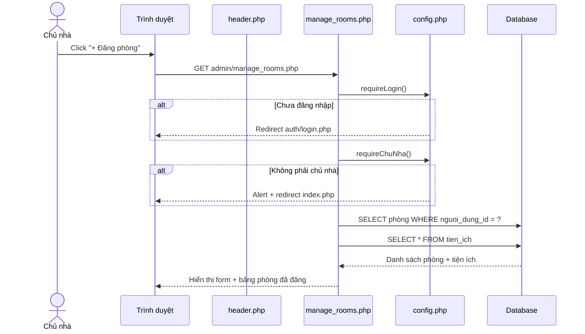
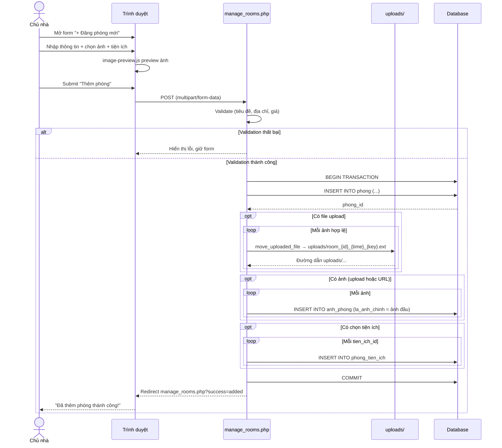
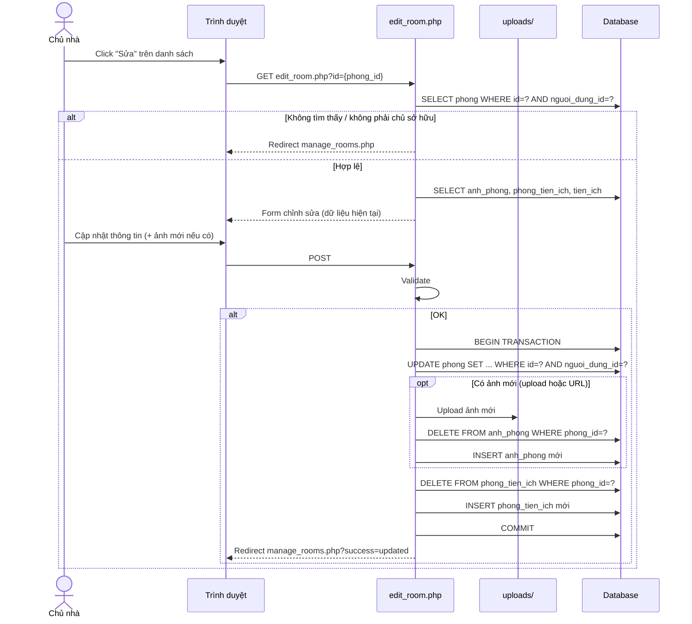
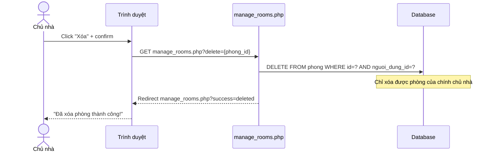

# Chức năng Đăng phòng

Tài liệu tổng hợp luồng **đăng / quản lý phòng** của Chủ nhà trong hệ thống Booking Phòng Trọ. Dùng làm cơ sở vẽ sơ đồ tuần tự (sequence diagram).

---

## 1. Tổng quan

| Mục | Nội dung |
|-----|----------|
| **Mục đích** | Chủ nhà đăng tin phòng trọ, kèm ảnh và tiện ích |
| **Người dùng** | Chỉ vai trò `chu_nha` |
| **Trang chính** | `admin/manage_rooms.php` |
| **Trang sửa** | `admin/edit_room.php` |
| **Quyền** | `requireLogin()` + `requireChuNha()` |

Nút **"+ Đăng phòng"** trên header dẫn tới `admin/manage_rooms.php`.

---

## 2. File liên quan

| File | Vai trò |
|------|---------|
| `admin/manage_rooms.php` | Form đăng phòng, danh sách phòng, xóa phòng |
| `admin/edit_room.php` | Chỉnh sửa phòng đã đăng |
| `config/config.php` | `requireChuNha()`, helper trạng thái phòng |
| `config/database.php` | Kết nối DB |
| `assets/js/image-preview.js` | Preview ảnh trước khi upload |
| `includes/header.php` | Menu "+ Đăng phòng" |
| `uploads/` | Thư mục lưu ảnh upload |
| `setup_tien_ich.sql` | Dữ liệu mẫu bảng `tien_ich` |

---

## 3. Bảng dữ liệu liên quan

```
nguoi_dung (1) ──────< (N) phong
                              │
                              ├──< anh_phong
                              └──< phong_tien_ich >── tien_ich
```

| Bảng | Mục đích |
|------|----------|
| `phong` | Thông tin phòng (`tieu_de`, `mo_ta`, `dia_chi`, `quan_huyen`, `gia`, `dien_tich`, `trang_thai`, `nguoi_dung_id`) |
| `anh_phong` | Ảnh phòng (`phong_id`, `duong_dan_anh`, `la_anh_chinh`) |
| `tien_ich` | Danh mục tiện ích |
| `phong_tien_ich` | Quan hệ N-N phòng ↔ tiện ích |
| `nguoi_dung` | Chủ nhà sở hữu phòng |

**Trạng thái phòng:** `con_trong` | `da_thue`

---

## 4. Trường nhập liệu form đăng phòng

| Trường | Bắt buộc | Ghi chú |
|--------|----------|---------|
| `tieu_de` | Có | Tiêu đề phòng |
| `gia` | Có | Số dương (đồng/tháng) |
| `dia_chi` | Có | Địa chỉ đầy đủ |
| `quan_huyen` | Không | Quận/Huyện |
| `dien_tich` | Không | m² |
| `trang_thai` | Không | Mặc định `con_trong` |
| `mo_ta` | Không | Mô tả chi tiết |
| `images_upload[]` | Không* | Upload nhiều ảnh (JPG/PNG/GIF/WEBP, ≤ 5MB/ảnh) |
| `images` | Không | URL ảnh, cách nhau bởi dấu phẩy |
| `tien_ich[]` | Không | Checkbox tiện ích |

\* Form ghi nhãn ảnh là bắt buộc về UI, nhưng backend vẫn cho lưu phòng nếu không có ảnh.

Ảnh đầu tiên trong danh sách được đánh dấu `la_anh_chinh = 1`.

Thông tin liên hệ lấy từ tài khoản chủ nhà (SĐT, email) — không nhập trên form.

---

## 5. Validation

1. Tiêu đề, địa chỉ, giá không được trống  
2. Giá phải là số > 0  
3. Ảnh upload: chỉ nhận `jpeg/jpg/png/gif/webp`, tối đa 5MB  
4. Chỉ chủ nhà sở hữu mới sửa/xóa được phòng của mình (`nguoi_dung_id = user.id`)

---

## 6. Sơ đồ tuần tự — Truy cập trang đăng phòng



---

## 7. Sơ đồ tuần tự — Đăng phòng mới (chính)



---

## 8. Sơ đồ tuần tự — Sửa phòng



---

## 9. Sơ đồ tuần tự — Xóa phòng



---

## 10. Luồng xử lý backend (tóm tắt bước)

### Thêm phòng (`manage_rooms.php` — POST)

1. Kiểm tra đăng nhập + vai trò chủ nhà  
2. Đọc & validate input  
3. `BEGIN TRANSACTION`  
4. `INSERT phong` → lấy `phong_id`  
5. Upload ảnh vào `uploads/` (nếu có)  
6. Gộp ảnh upload + URL → `INSERT anh_phong`  
7. `INSERT phong_tien_ich` (nếu có)  
8. `COMMIT` → redirect `?success=added`  
9. Nếu lỗi → `ROLLBACK` + hiện thông báo  

### Sửa phòng (`edit_room.php` — POST)

1. Kiểm tra phòng thuộc chủ nhà  
2. Validate → `UPDATE phong`  
3. Nếu có ảnh mới: xóa `anh_phong` cũ, thêm ảnh mới  
4. Thay thế toàn bộ `phong_tien_ich`  
5. Redirect `?success=updated`  

---

## 11. Actors trong sơ đồ tuần tự

Khi vẽ diagram (PlantUML / Mermaid / StarUML), dùng các actor/participant sau:

| Actor / Object | Mô tả |
|----------------|--------|
| **Chủ nhà** | Người dùng đã đăng nhập, `vai_tro = chu_nha` |
| **Trình duyệt** | UI form, preview ảnh, confirm xóa |
| **manage_rooms.php** | Controller đăng / liệt kê / xóa |
| **edit_room.php** | Controller sửa phòng |
| **config.php** | Kiểm tra quyền |
| **Database** | `phong`, `anh_phong`, `phong_tien_ich`, `tien_ich` |
| **uploads/** | Lưu file ảnh vật lý |

---

## 12. Ghi chú kỹ thuật

- Form dùng `enctype="multipart/form-data"` để upload nhiều ảnh.  
- Tên file upload: `room_{phong_id}_{timestamp}_{index}.{ext}`.  
- Ảnh đầu tiên = ảnh chính (`la_anh_chinh = 1`).  
- Khi sửa: upload/URL mới sẽ **thay thế toàn bộ** ảnh cũ.  
- Xóa phòng chủ nhà chỉ `DELETE FROM phong` theo `nguoi_dung_id` (khác với admin xóa đầy đủ quan hệ ở `manage_phong.php` / `delete_room_admin.php`).  
- Giao dịch DB đảm bảo phòng / ảnh / tiện ích đồng bộ khi thêm hoặc sửa.

---

## 13. Kết quả sau khi đăng

- Phòng xuất hiện trong **Danh sách phòng đã đăng** của chủ nhà.  
- Phòng hiển thị trên trang chủ (`index.php`) và chi tiết (`room_detail.php`).  
- Chủ nhà có thể **Xem / Sửa / Xóa** từ bảng quản lý.  
- Người thuê có thể xem, yêu thích, đặt phòng.

---

*Nguồn code: `admin/manage_rooms.php`, `admin/edit_room.php`, `config/config.php`, `assets/js/image-preview.js`*
