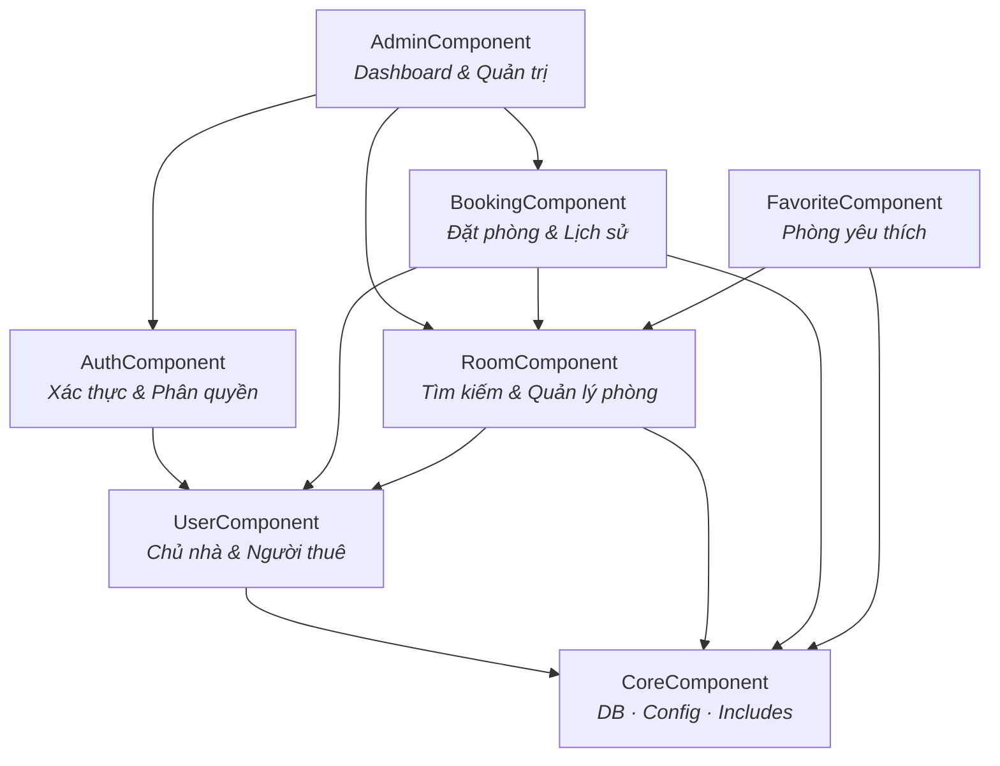
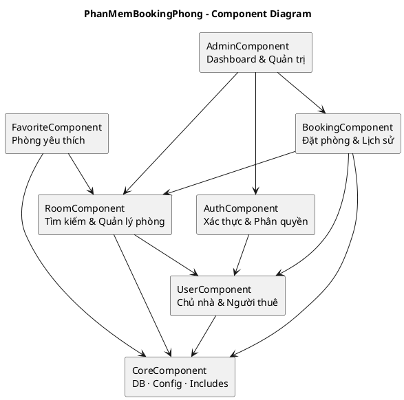

# Thiết kế Component – PhanMemBookingPhong

> Tài liệu tổng hợp: **Bảng Component · Bảng Interface · Bảng Dependency · Component Diagram**  
> Dự án: Phần mềm Booking Phòng Trọ (`PhanMemBookingPhong`)

---

## 1. Bảng Component

| Component | Trách nhiệm |
|-----------|-------------|
| **AdminComponent** | Dashboard quản trị, thống kê tổng quan hệ thống |
| **AuthComponent** | Đăng nhập, đăng ký, đăng xuất, phân quyền (admin / chủ nhà / người thuê) |
| **BookingComponent** | Đặt phòng, xác nhận/hủy, xem lịch sử đặt phòng |
| **RoomComponent** | Đăng tin phòng, tìm kiếm/lọc, xem chi tiết, cập nhật trạng thái |
| **UserComponent** | Quản lý chủ nhà và người thuê |
| **FavoriteComponent** | Thêm / xóa / xem danh sách phòng yêu thích |
| **CoreComponent** | Database (PDO), Config, Header/Footer dùng chung |

---

## 2. Bảng Interface

| Component | Interface (hàm / chức năng cung cấp) |
|-----------|--------------------------------------|
| **AdminComponent** | `getDashboardStats()`, `manageSystem()` |
| **AuthComponent** | `login()`, `register()`, `logout()`, `requireLogin()`, `requireNguoiThue()`, `isAdmin()` |
| **BookingComponent** | `createBooking()`, `listMyBookings()`, `confirmBooking()`, `deleteBooking()` |
| **RoomComponent** | `searchRoom()`, `getRoomDetail()`, `createRoom()`, `updateRoom()`, `deleteRoom()` |
| **UserComponent** | `listChuNha()`, `listNguoiThue()`, `viewUser()`, `deleteUser()` |
| **FavoriteComponent** | `addFavorite()`, `removeFavorite()`, `listFavorites()` |
| **CoreComponent** | `getDBConnection()`, config hằng số, `header.php` / `footer.php` |

### Map nhanh sang file trong project

| Component | File chính |
|-----------|------------|
| AdminComponent | `admin/dashboard.php` |
| AuthComponent | `auth/login.php`, `register.php`, `logout.php`, `forgot_password.php`, `reset_password.php` |
| BookingComponent | `booking.php`, `my_bookings.php`, `admin/manage_bookings.php`, `admin/bookings.php` |
| RoomComponent | `index.php`, `room_detail.php`, `admin/manage_phong.php`, `admin/edit_room.php`, `admin/manage_rooms.php` |
| UserComponent | `admin/manage_chu_nha.php`, `admin/manage_nguoi_thue.php`, `admin/view_chu_nha.php`, `admin/view_nguoi_thue.php` |
| FavoriteComponent | `favorites.php`, `favorite_action.php` |
| CoreComponent | `config/database.php`, `config/config.php`, `includes/header.php`, `includes/footer.php` |

---

## 3. Bảng Dependency

| Mối quan hệ | Ý nghĩa |
|-------------|---------|
| **Admin → Auth** | Dashboard chỉ dành cho tài khoản đã xác thực (admin) |
| **Admin → Booking** | Thống kê / quản lý đơn đặt phòng trên hệ thống |
| **Admin → Room** | Quản lý danh sách phòng toàn hệ thống |
| **Auth → User** | Đăng nhập / phân quyền dựa trên thông tin người dùng |
| **Booking → User** | Đơn đặt gắn với người thuê (và liên quan chủ nhà) |
| **Booking → Room** | Đặt phòng cần kiểm tra phòng còn trống, không đặt phòng của chính mình |
| **Room → User** | Phòng thuộc về chủ nhà (`nguoi_dung_id`) |
| **Favorite → Room** | Yêu thích trỏ tới phòng tồn tại |
| **User → Core** | Đọc/ghi bảng `nguoi_dung`, `admin` qua Database |
| **Room → Core** | Đọc/ghi bảng `phong` qua Database |
| **Booking → Core** | Đọc/ghi bảng `dat_phong` qua Database |
| **Favorite → Core** | Đọc/ghi dữ liệu yêu thích qua Database |

### Dạng rút gọn (giống slide mẫu)

| Mối quan hệ | Ý nghĩa |
|-------------|---------|
| `BookingComponent → RoomComponent` và `BookingComponent → UserComponent` | Tạo đơn đặt phải kiểm tra phòng hợp lệ và gắn đúng người thuê |
| `BookingComponent → AuthComponent` | Chỉ người thuê đã đăng nhập mới đặt được phòng |
| `FavoriteComponent → RoomComponent` | Lưu yêu thích dựa trên thông tin phòng |
| `AdminComponent → Booking / Room / Auth` | Quản trị cần dữ liệu đặt phòng, phòng và phiên đăng nhập |
| `User / Room / Booking / Favorite → CoreComponent` | Các component nghiệp vụ dùng DB + config dùng chung |

---

## 4. Component Diagram (đơn giản – kiểu layered)

Cấu trúc giống sơ đồ mẫu (tầng trên phụ thuộc tầng dưới):

```text
                    AdminComponent
                 (Dashboard & Quản trị)
                           |
          +----------------+----------------+
          |                |                |
    AuthComponent   BookingComponent   RoomComponent
   (Xác thực)      (Đặt phòng)        (Quản lý phòng)
          |           |    |                |
          |           |    +--------+       |
          |           |             |       |
          v           v             v       v
     UserComponent              FavoriteComponent
   (Chủ nhà & Người thuê)      (Phòng yêu thích)
          |                         |       ^
          |                         |       |
          +------------+------------+       |
                       |                    |
                       v                    |
                 CoreComponent --------------+
            (DB, Config, Header/Footer)
```

### Code Mermaid – dán Draw.io

**Arrange → Insert → Advanced → Mermaid…**



### Code PlantUML (tuỳ chọn)

**Arrange → Insert → Advanced → PlantUML…**



---

## 5. Quy ước đọc sơ đồ

- Mũi tên **A → B** nghĩa là **A phụ thuộc B** (A cần dùng B để hoàn thành tác vụ).
- Tầng trên = chức năng tổng hợp / nghiệp vụ.
- Tầng dưới = quản lý thực thể + hạ tầng dùng chung (`CoreComponent`).

---

## 6. Checklist nộp bài

- [ ] Bảng Component
- [ ] Bảng Interface
- [ ] Bảng Dependency
- [ ] Component Diagram (export PNG từ Draw.io)
