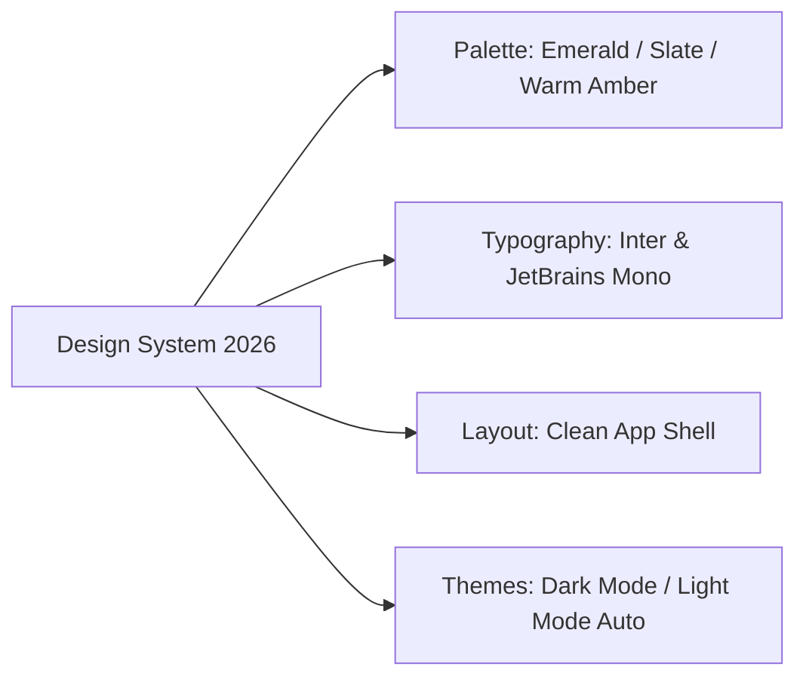
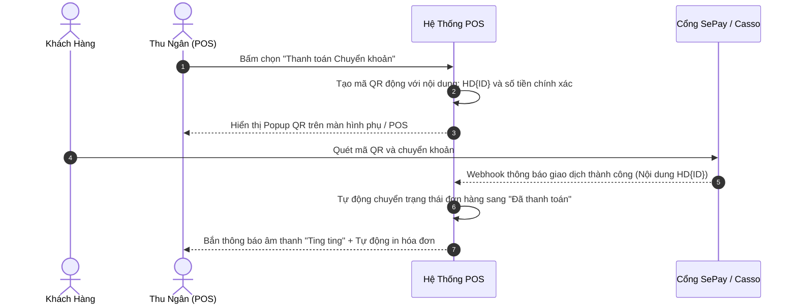
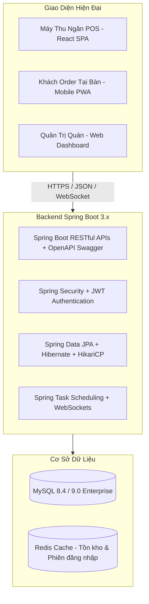

# KẾ HOẠCH RÀ SOÁT TOÀN DIỆN VÀ NÂNG CẤP HỆ THỐNG QUẢN LÝ BÁN HÀNG (POS)

> **Dự án:** Quản Lý Bán Hàng (QuanLyBanHang-Java)  
> **Kiến trúc hiện tại:** Java 21, Jakarta EE 10 / Servlet 6.0, JSP 3.1 + JSTL, MySQL 8/9, HikariCP, Vite + React (Pilot)  
> **Mục tiêu:** Rà soát toàn bộ dự án, định danh lỗi/lỗ hổng bảo mật, và xây dựng lộ trình nâng cấp toàn diện từ Giao diện (UI/UX) đến Chức năng & Kiến trúc kỹ thuật.

---

## MỤC LỤC
1. [TỔNG QUAN HIỆN TRẠNG DỰ ÁN](#1-tổng-quan-hiện-trạng-dự-án)
2. [BÁO CÁO RÀ SOÁT CHI TIẾT: CÁC LỖI & VẤN ĐỀ CẦN SỬA NGAY](#2-báo-cáo-rà-soát-chi-tiết-các-lỗi--vấn-đề-cần-sửa-ngay)
   - [2.1. Lỗi nghiêm trọng (Critical / High)](#21-lỗi-nghiêm-trọng-critical--high)
   - [2.2. Lỗi bảo mật (Security Vulnerabilities)](#22-lỗi-bảo-mật-security-vulnerabilities)
   - [2.3. Lỗi hiệu năng & Truy vấn CSDL (Performance & Database Bottlenecks)](#23-lỗi-hiệu-năng--truy-vấn-csdl-performance--database-bottlenecks)
   - [2.4. Lỗi nghiệp vụ & Logic dữ liệu (Business Logic Flaws)](#24-lỗi-nghiệp-vụ--logic-dữ-liệu-business-logic-flaws)
   - [2.5. Lỗi giao diện & In ấn hóa đơn (UI/UX & Printing Deficiencies)](#25-lỗi-giao-diện--in-ấn-hóa-đơn-uiux--printing-deficiencies)
3. [KẾ HOẠCH NÂNG CẤP GIAO DIỆN (UI/UX MODERNIZATION)](#3-kế-hoạch-nâng-cấp-giao-diện-uiux-modernization)
   - [3.1. Chuẩn hóa Design System & Bảng màu](#31-chuẩn-hóa-design-system--bảng-màu)
   - [3.2. Nâng cấp toàn diện Màn hình Bán hàng (POS Modern Screen)](#32-nâng-cấp-toàn-diện-màn-hình-bán-hàng-pos-modern-screen)
   - [3.3. Tái cấu trúc Dashboard & Báo cáo với Biểu đồ hiện đại](#33-tái-cấu-trúc-dashboard--báo-cáo-với-biểu-đồ-hiện-đại)
   - [3.4. Tối ưu bảng biểu, Phân trang và Bộ lọc dữ liệu](#34-tối-ưu-bảng-biểu-phân-trang-và-bộ-lọc-dữ-liệu)
   - [3.5. Tái cấu trúc và dọn dẹp core.css](#35-tái-cấu-trúc-và-dọn-dẹp-corecss)
4. [KẾ HOẠCH NÂNG CẤP CHỨC NĂNG & NGHIỆP VỤ (FEATURE UPGRADE PLAN)](#4-kế-hoạch-nâng-cấp-chức-năng--nghiệp-vụ-feature-upgrade-plan)
   - [4.1. Hệ thống Định lượng & Trừ kho tự động (BOM / Recipe Engine)](#41-hệ-thống-định-lượng--trừ-kho-tự-động-bom--recipe-engine)
   - [4.2. Thanh toán VietQR Động & Tự động khớp giao dịch (Dynamic QR Webhook)](#42-thanh-toán-vietqr-động--tự-động-khớp-giao-dịch-dynamic-qr-webhook)
   - [4.3. Nâng cấp Quản lý Ca làm việc (Shift Management)](#43-nâng-cấp-quản-lý-ca-làm-việc-shift-management)
   - [4.4. In ấn hóa đơn Barista / Bếp / Khách hàng chuyên nghiệp](#44-in-ấn-hóa-đơn-barista--bếp--khách-hàng-chuyên-nghiệp)
   - [4.5. Khách hàng thân thiết & Tích điểm (CRM & Loyalty Points)](#45-khách-hàng-thân-thiết--tích-điểm-crm--loyalty-points)
   - [4.6. Nâng cấp Quản lý Bàn / Phòng (Dành cho F&B)](#46-nâng-cấp-quản-lý-bàn--phòng-dành-cho-fb)
   - [4.7. Tự động hóa tác vụ ngầm (Background Automation & Cron Engine)](#47-tự-động-hóa-tác-vụ-ngầm-background-automation--cron-engine)
5. [KẾ HOẠCH NÂNG CẤP KIẾN TRÚC KỸ THUẬT (ARCHITECTURE ROADMAP)](#5-kế-hoạch-nâng-cấp-kiến-trúc-kỹ-thuật-architecture-roadmap)
   - [5.1. Ngắn hạn: Chuẩn hóa Jakarta Servlet + React](#51-ngắn-hạn-chuẩn-hóa-jakarta-servlet--react)
   - [5.2. Dài hạn: Chuyển đổi sang Spring Boot 3 + REST API + SPA](#52-dài-hạn-chuyển-đổi-sang-spring-boot-3--rest-api--spa)
6. [LỘ TRÌNH TRIỂN KHAI THEO GIAI ĐOẠN (SPRINT MILESTONES)](#6-lộ-trình-triển-khai-theo-giai-đoạn-sprint-milestones)

---

## 1. TỔNG QUAN HIỆN TRẠNG DỰ ÁN

Dự án **QuanLyBanHang-Java** là sản phẩm chuyển đổi (migration) từ mã nguồn PHP thuần sang Java Web trên nền tảng Servlet 6.0/JSP và chạy trên Tomcat 10.1.

### Điểm mạnh:
- Kiến trúc phân lớp rõ ràng: `controller`, `service`, `dao`, `model`, `filter`, `util`.
- Quản lý kết nối CSDL tốt thông qua **HikariCP** Connection Pool.
- Mã hóa mật khẩu bảo mật chuẩn bằng **jBCrypt**.
- Đã bước đầu tích hợp giao diện hiện đại **React + Vite** cho màn hình tạo đơn hàng (`order-create`).
- Đã có tính năng xuất báo cáo CSV, quét mã QR thanh toán qua VietQR URL, quản lý hạn dùng kho nguyên liệu (expiry alerts).

### Điểm yếu & Thách thức:
- Mã nguồn React chưa được build bundle; còn thiếu tính năng mã giảm giá so với bản legacy JSP.
- Thiếu cơ chế bảo vệ CSRF và kiểm soát tải tệp (file upload).
- Tồn tại nhiều truy vấn metadata CSDL (`information_schema`) gây nghẽn hiệu năng trên từng request.
- Nghiệp vụ bán hàng và kho hàng đang vận hành tách rời (chưa có công thức định lượng trừ kho tự động khi bán sản phẩm).
- Tệp định kiểu `core.css` quá lớn (5.639 dòng), gộp nhiều đoạn mã CSS rời rạc, khó mở rộng.

---

## 2. BÁO CÁO RÀ SOÁT CHI TIẾT: CÁC LỖI & VẤN ĐỀ CẦN SỬA NGAY

### 2.1. Lỗi nghiêm trọng (Critical / High)

#### Lỗi 1: Bundle React chưa được build & Thiếu chức năng Voucher trên bản React
- **Vị trí:**  
  - JSP gọi bundle: `src/main/webapp/WEB-INF/views/donhang/create.jsp` (dòng 13, 19).
  - Thư mục frontend: `frontend/order-create/`.
  - File API React: `frontend/order-create/src/api.ts` (dòng 88-100).
- **Hiện trạng:**
  - `create.jsp` kiểm tra tệp `/assets/react/order-create/order-create.js`. Nếu không có, ứng dụng buộc phải quay về màn hình cũ `create-legacy.jspf`. Hiện tại bundle này **chưa hề được build** (không có `node_modules`).
  - Khi kiểm tra mã nguồn TypeScript của React trong `frontend/order-create`, đối tượng `SubmitOrderPayload` và hàm `submitOrder()` **hoàn toàn không hỗ trợ `ma_giam`** (mã giảm giá). Trong khi đó, bản legacy JSP `create.js` lại có tính năng nhập và trừ tiền voucher. Nếu lập trình viên build và kích hoạt React, khách hàng/thu ngân sẽ bị mất hoàn toàn tính năng áp mã giảm giá!
- **Giải pháp sửa chữa:**
  1. Thêm trường `ma_giam?: string` vào `SubmitOrderPayload` trong `types.ts` và truyền kèm `params.append('ma_giam', payload.ma_giam)` trong `api.ts`.
  2. Bổ sung giao diện ô nhập mã voucher + nút "Áp dụng" vào `OrderCreateApp.tsx` hoặc modal thanh toán, gọi API `/api/ma-giam-gia/kiem-tra`.
  3. Chạy `npm install` và `npm run build` để xuất tệp `order-create.js` vào `src/main/webapp/assets/react/order-create/`.

---

#### Lỗi 2: Sai lệch doanh thu ca làm do đơn hàng không được gán mã ca (`ca_lam_id`)
- **Vị trí:**  
  - `vn.quanlybanhang.dao.ShiftDao.java` (dòng 96):
    ```sql
    SELECT ... FROM donhang WHERE trang_thai = ? AND nhanvien_id = ? AND ngay_tao >= ?
    ```
  - `vn.quanlybanhang.service.OrderService.java`
- **Hiện trạng:**
  - Bảng `donhang` chỉ lưu `nhanvien_id`, không lưu `ca_lam_id`.
  - `ShiftDao.totalsForStaff` chỉ so sánh `ngay_tao >= openedAt`. Nếu nhân viên mở ca, đóng ca lúc 12:00, sau đó tạo đơn ngoài ca hoặc mở ca 2 lúc 13:00, toàn bộ đơn phát sinh từ trước sẽ bị tính chồng chéo hoặc tính sai vào ca tiếp theo.
  - Hệ thống cho phép thu ngân tạo đơn hàng ngay cả khi **chưa mở ca làm việc**, dẫn đến tiền mặt trong ca không đối soát được khi kiểm quỹ.
- **Giải pháp sửa chữa:**
  1. Thêm cột `ca_lam_id INT NULL REFERENCES ca_lam_viec(id)` vào bảng `donhang`.
  2. Cập nhật `OrderService`: Bắt buộc kiểm tra nhân viên đã mở ca chưa (`ShiftService.openShift(staffId)`). Nếu chưa mở ca, từ chối tạo đơn hoặc hiển thị thông báo yêu cầu "Mở ca đầu ngày".
  3. Gán trực tiếp `ca_lam_id` khi insert đơn hàng. Khi kết ca, đối chiếu doanh thu theo chính xác `ca_lam_id`.

---

#### Lỗi 3: Chưa có định lượng món (BOM) & Không tự động trừ kho nguyên liệu khi bán hàng
- **Vị trí:**  
  - `vn.quanlybanhang.service.OrderService.java`
  - `vn.quanlybanhang.dao.WarehouseDao.java`
  - `vn.quanlybanhang.dao.NguyenVatLieuDao.java`
- **Hiện trạng:**
  - Hệ thống quản lý song song hai danh mục: "Sản phẩm bán" (`sanpham`) và "Nguyên vật liệu kho" (`nguyen_vat_lieu`).
  - Tuy nhiên, **hoàn toàn không có liên kết** giữa sản phẩm bán ra và nguyên liệu tiêu hao (ví dụ: 1 ly Cà phê sữa Size L cần 25g cà phê hạt, 40ml sữa đặc, 1 ly nhựa 500ml).
  - Khi hoàn thành đơn hàng (`trang_thai = 'hoan_thanh'`), kho hàng không hề bị trừ một đơn vị nguyên liệu nào.
  - Phân hệ kiểm kho (`KiemKhoService`) chỉ đối chiếu thủ công trên giấy tờ mà không có số liệu tồn kho lý thuyết chính xác.
- **Giải pháp sửa chữa:**
  - Thiết kế bảng `cong_thuc_sanpham` (Recipe / BOM) và bổ sung trigger/service tự động trừ tồn kho khi đơn hàng hoàn thành (Xem chi tiết tại [Mục 4.1](#41-hệ-thống-định-lượng--trừ-kho-tự-động-bom--recipe-engine)).

---

### 2.2. Lỗi bảo mật (Security Vulnerabilities)

#### Lỗi 4: Hoàn toàn thiếu cơ chế bảo vệ CSRF (Cross-Site Request Forgery)
- **Vị trí:** Toàn bộ hệ thống Controller nhận POST (`AuthController`, `OrderController`, `NhanVienController`, `WarehouseController`, `SettingsController`, `VoucherController`).
- **Hiện trạng:**
  - Không có bất kỳ `CSRF Token` nào được sinh ra hoặc kiểm tra trong session.
  - Kẻ tấn công có thể tạo một trang HTML chứa form tự động submit ngầm đến `http://localhost:8080/quanlybanhang/nhan-vien/delete?id=2` hoặc `.../nhan-vien/change-role`. Nếu người quản lý đang đăng nhập, tài khoản sẽ bị thay đổi hoặc xóa mà không hề hay biết.
- **Giải pháp sửa chữa:**
  - Viết `CsrfFilter` và `CsrfUtil`: Tự động tạo token ngẫu nhiên lưu vào Session.
  - Nhúng `<input type="hidden" name="_csrf" value="${csrfToken}">` vào tất cả các form POST trong JSP và gửi header `X-CSRF-Token` trong các request AJAX/Fetch.

---

#### Lỗi 5: Lỗ hổng tải tệp hình ảnh không giới hạn định dạng (Unrestricted File Upload)
- **Vị trí:**  
  - `vn.quanlybanhang.service.ProductImageUploadService.java` (dòng 56-62)
  - `vn.quanlybanhang.service.LogoUploadService.java` (dòng 50-56)
- **Hiện trạng:**
  ```java
  private static String getExtension(Part part) {
      String submitted = part.getSubmittedFileName();
      if (submitted == null || !submitted.contains(".")) {
          return ".png";
      }
      return submitted.substring(submitted.lastIndexOf('.'));
  }
  ```
  - Dịch vụ chỉ kiểm tra MIME type `part.getContentType().startsWith("image/")` (rất dễ làm giả qua Postman/cURL) nhưng lại lấy đuôi file trực tiếp từ tên file của người dùng gửi lên.
  - Kẻ tấn công có thể gửi file có tên `exploit.jsp` hoặc `malicious.svg` (chứa script XSS) với `Content-Type: image/jpeg`. File này sẽ được lưu thẳng vào thư mục upload.
  - Không giới hạn dung lượng tải lên (Max File Size), có nguy cơ bị tấn công làm tràn đĩa cứng (DoS).
- **Giải pháp sửa chữa:**
  - Thiết lập danh sách đuôi file cho phép cố định (Whitelist): `.jpg`, `.jpeg`, `.png`, `.webp`. Bất kỳ đuôi nào khác đều từ chối hoặc ép về `.png`/`.jpg`.
  - Giới hạn dung lượng upload tối đa (ví dụ 5MB) thông qua `@MultipartConfig(maxFileSize = 5242880L)`.
  - Xác thực magic bytes (file signature) thực tế bằng thư viện chuyên dụng hoặc `ImageIO.read()`.

---

#### Lỗi 6: AuthFilter chuyển hướng 302 cho các request API không đăng nhập
- **Vị trí:** `vn.quanlybanhang.filter.AuthFilter.java` (dòng 53-56):
  ```java
  if (!SessionUtil.isLoggedIn(httpRequest)) {
      httpResponse.sendRedirect(contextPath + "/login");
      return;
  }
  ```
- **Hiện trạng:**
  - Khi phiên làm việc (Session) hết hạn, nếu trang React hoặc các hàm AJAX gọi `/api/don-hang/create`, `/api/search-customer`, hệ thống sẽ trả về mã HTTP `302 Found` và nội dung HTML của trang đăng nhập.
  - JavaScript `fetch()` nhận phản hồi HTML và parse bằng `JSON.parse()`, gây ra lỗi không thể xử lý: `Uncaught (in promise) SyntaxError: Unexpected token '<' in JSON at position 0`. Người dùng chỉ thấy ứng dụng bị treo (freeze) mà không rõ lý do.
- **Giải pháp sửa chữa:**
  - Kiểm tra nếu `path.startsWith("/api/")` hoặc request có header `Accept: application/json` / `X-Requested-With: XMLHttpRequest`:
    ```java
    if (isApiRequest(httpRequest)) {
        httpResponse.setStatus(HttpServletResponse.SC_UNAUTHORIZED);
        httpResponse.setContentType("application/json;charset=UTF-8");
        httpResponse.getWriter().write("{\"success\":false,\"error\":\"Phiên làm việc đã hết hạn. Vui lòng đăng nhập lại.\",\"code\":\"UNAUTHORIZED\"}");
        return;
    }
    ```

---

#### Lỗi 7: Lỗ hổng XSS tiềm ẩn do in trực tiếp biểu thức EL và inline JavaScript
- **Vị trí:**  
  - `src/main/webapp/WEB-INF/views/nhanvien/index.jsp` (dòng 53):
    ```html
    <button type="button" onclick="changeRole(${employee.id}, '${employee.tenNhanVien}', '${employee.chucVu}', this)">
    ```
  - Các trang `khachhang/index.jsp`, `donhang/index.jsp`, `sanpham/index.jsp`.
- **Hiện trạng:**
  - Nếu tên nhân viên hoặc khách hàng có dấu nháy đơn (`Nguyễn O'Reilly`), cú pháp JavaScript bị vỡ dẫn đến lỗi `SyntaxError`.
  - Nếu trường tên chứa chuỗi mã độc `'); alert('XSS');//`, script độc hại sẽ được thực thi ngay trên trình duyệt của quản lý.
  - Các biến EL trong bảng được in trực tiếp bằng `${employee.tenNhanVien}` thay vì được escape XML.
- **Giải pháp sửa chữa:**
  - Không truyền chuỗi nhạy cảm qua inline `onclick="..."`. Sử dụng `data-attribute`:
    ```html
    <button type="button" class="btn-change-role" data-id="${employee.id}" data-name="<c:out value="${employee.tenNhanVien}"/>" data-role="${employee.chucVu}">
    ```
  - Luôn sử dụng `<c:out value="${...}" />` cho dữ liệu nhập từ người dùng.

---

### 2.3. Lỗi hiệu năng & Truy vấn CSDL (Performance & Database Bottlenecks)

#### Lỗi 8: Lặp lại truy vấn `information_schema` trên từng thao tác ghi/đọc
- **Vị trí:**  
  - `vn.quanlybanhang.dao.OrderDao.java` (dòng 163, 299): Hàm `columnExists()` truy vấn bảng `information_schema.COLUMNS` mỗi khi hoàn tất một đơn hàng!
  - `vn.quanlybanhang.dao.ReportDao.java` (dòng 64, 155): Hàm `hasPaymentMethod()` và `tableExists()` truy vấn metadata mỗi lần xem báo cáo.
  - `vn.quanlybanhang.dao.AuditDao.java` (dòng 14): Truy vấn kiểm tra bảng audit tồn tại trước mỗi thao tác ghi log.
- **Hiện trạng:**
  - `information_schema` trong MySQL là view ảo với chi phí khóa và phân tích rất đắt đỏ. Việc kiểm tra metadata này trên từng transaction đơn hàng sẽ làm chậm nghiêm trọng tốc độ bán hàng tại quầy khi quán đông khách.
  - Trên thực tế, tệp `SchemaBootstrap.java` đã chạy lúc server khởi động và đảm bảo cấu trúc bảng đã được tạo đầy đủ.
- **Giải pháp sửa chữa:**
  - Xóa bỏ việc kiểm tra `information_schema` động trong `OrderDao.stampStaffAndVoucher`. Chuyển các cột `nhanvien_id` và `ma_giam` vào trực tiếp câu lệnh `INSERT INTO donhang` ban đầu.
  - Cache kết quả kiểm tra bảng/cột một lần duy nhất lúc khởi động ứng dụng (`SchemaBootstrap`).

---

#### Lỗi 9: Thiếu phân trang Server-side trên các danh sách dữ liệu lớn
- **Vị trí:**  
  - `vn.quanlybanhang.dao.KhachHangDao.java`: `SELECT * FROM khachhang ORDER BY ngay_tao DESC` (không có LIMIT).
  - `vn.quanlybanhang.dao.OrderDao.java`: Hardcode `LIMIT 300` cố định.
  - `vn.quanlybanhang.dao.ProductDao.java`: Tải toàn bộ sản phẩm lên bộ nhớ.
- **Hiện trạng:**
  - Khi cơ sở dữ liệu đạt 5.000 - 50.000 khách hàng hoặc hóa đơn, việc load toàn bộ bản ghi vào RAM của JVM và render ra một bảng HTML khổng lồ sẽ gây nghẽn CPU, tràn Heap Memory và làm đơ trình duyệt của thu ngân.
- **Giải pháp sửa chữa:**
  - Viết lớp dùng chung `Page<T>` và `Pageable(int page, int size)`.
  - Bổ sung `COUNT(*)` và `LIMIT ? OFFSET ?` vào tất cả các DAO tìm kiếm.
  - Xây dựng component phân trang tái sử dụng trên giao diện JSP.

---

### 2.4. Lỗi nghiệp vụ & Logic dữ liệu (Business Logic Flaws)

#### Lỗi 10: Tự động hóa ngầm (Scripts) bị chặn bởi AuthFilter
- **Vị trí:**  
  - `scripts/run-expiry-alerts.ps1`
  - `scripts/run-rebuild-revenue.ps1`
- **Hiện trạng:**
  - Các script này cần chạy định kỳ hàng ngày (qua Windows Task Scheduler hoặc cron) để cập nhật cảnh báo hạn dùng kho và chốt doanh thu ngày.
  - Tuy nhiên, endpoint `/api/kho/check-expiry-alerts` và `/api/rebuild-daily-revenue` lại nằm dưới quyền kiểm soát của `AuthFilter`, đòi hỏi phải đăng nhập và copy tay `JSESSIONID` từ trình duyệt. Điều này biến việc tự động hóa thành thủ công!
- **Giải pháp sửa chữa:**
  - Thiết lập cơ chế xác thực bằng Secret API Key cho các endpoint nội bộ:
    ```
    POST /api/internal/check-expiry-alerts?api_key=SECRET_TOKEN
    ```
  - Cho phép cấu hình Secret Token này trong tệp cấu hình hệ thống, bỏ qua session cookie của người dùng.
  - Hoặc tích hợp `ScheduledExecutorService` chạy trực tiếp bên trong `AppContextListener` của Java, không cần gọi API qua script ngoài.

---

#### Lỗi 11: Hủy đơn hàng thiếu lý do và không ghi nhận vết kiểm toán (Audit Trail)
- **Vị trí:** `vn.quanlybanhang.controller.OrderController.java` (`/don-hang/cancel`), `OrderService.java`.
- **Hiện trạng:**
  - Khi nhân viên bấm "Xác nhận hủy đơn hàng", hệ thống lập tức chuyển trạng thái sang `da_huy` mà không yêu cầu nhập bất kỳ lý do hủy nào (ví dụ: Khách đổi ý, Sai món, Trùng đơn, Pha chế hỏng).
  - Không có trường `ly_do_huy`, `nguoi_huy_id`, `ngay_huy` trong bảng `donhang`.
  - Trong môi trường bán lẻ/nhà hàng, đây là kẽ hở lớn dẫn đến nguy cơ gian lận doanh thu (nhân viên thu tiền mặt của khách xong tự ý hủy đơn trên hệ thống để chiếm đoạt tiền).
- **Giải pháp sửa chữa:**
  - Thêm trường `ly_do_huy VARCHAR(255)` và `nguoi_huy_id INT` vào bảng `donhang`.
  - Bắt buộc nhập lý do hủy trên màn hình hủy đơn và lưu vào nhật ký kiểm toán.

---

### 2.5. Lỗi giao diện & In ấn hóa đơn (UI/UX & Printing Deficiencies)

#### Lỗi 12: Hóa đơn in (`print.jsp`) bỏ sót hoàn toàn Topping / Tùy chọn món
- **Vị trí:** `src/main/webapp/WEB-INF/views/donhang/print.jsp` (dòng 37-43):
  ```html
  <c:forEach var="line" items="${order.items}">
      <tr>
          <td>${line.tenSanPham}<c:if test="${not empty line.size}"> (${line.size})</c:if><br><span class="muted">x${line.soLuong}</span></td>
          <td class="right"><fmt:formatNumber value="${line.thanhTien}" pattern="#,##0"/>đ</td>
      </tr>
  </c:forEach>
  ```
- **Hiện trạng:**
  - Trong khi `view.jsp` có render `line.luaChonList`, trang in hóa đơn lại hoàn toàn **bỏ quên** danh sách topping/tùy chọn (đường, đá, trân châu, pudding...).
  - Khi thu ngân in hóa đơn đưa cho quầy pha chế hoặc đưa khách, người pha chế không biết khách chọn mức đường, đá hay topping nào, dẫn đến phục vụ sai món.
- **Giải pháp sửa chữa:**
  - Cập nhật vòng lặp in chi tiết topping đi kèm từng sản phẩm trong `print.jsp` và định dạng thụt dòng hiển thị rõ ràng.

---

#### Lỗi 13: Lỗi hiển thị đơn vị tiền tệ trên Dashboard
- **Vị trí:** `src/main/webapp/WEB-INF/views/home/home-stats.jspf` (dòng 15):
  ```html
  <div class="number"><fmt:formatNumber value="${todayRevenue}" pattern="#,##0" />d</div>
  ```
- **Hiện trạng:** Hiển thị chữ `d` thường (`1,500,000d`) thay vì ký hiệu chuẩn tiền tệ Việt Nam `đ` hoặc `VNĐ`.
- **Giải pháp sửa chữa:** Đổi thành `đ` hoặc `VNĐ`.

---

## 3. KẾ HOẠCH NÂNG CẤP GIAO DIỆN (UI/UX MODERNIZATION)

### 3.1. Chuẩn hóa Design System & Bảng màu
Xây dựng một hệ thống nhận diện giao diện hiện đại, chuyên nghiệp, đạt chuẩn POS thương mại:



- **Màu sắc chủ đạo (Primary Palette):**
  - Brand Primary: `#059669` (Emerald 600 - tạo cảm giác tin cậy, kinh doanh thịnh vượng) kết hợp điểm nhấn Warm Amber `#f59e0b`.
  - Neutral Background: `#f8fafc` (Slate 50) cho Light Mode, `#0f172a` (Slate 900) cho Dark Mode.
  - Surface Card: `#ffffff` với viền mỏng `#e2e8f0` và đổ bóng mềm `box-shadow: 0 1px 3px rgba(0,0,0,0.05)`.
- **Typography:**
  - Nhúng Google Font `Plus Jakarta Sans` hoặc `Inter` cho chữ thường, hiển thị số tiền và mã đơn bằng phông số đều `JetBrains Mono` hoặc `Roboto Mono`.
- **Bộ icon:** Chuẩn hóa FontAwesome 6 Pro hoặc Lucide Icons hiện đại.

---

### 3.2. Nâng cấp toàn diện Màn hình Bán hàng (POS Modern Screen)

Màn hình bán hàng là "trái tim" của hệ thống POS. Kế hoạch nâng cấp tập trung vào tốc độ và sự tiện dụng tối đa:

```
+--------------------------------------------------------------------------------------------------+
|  [Logo] Quán Cafe ABC   |  [Bàn 05]   |  Tìm sản phẩm (F3 / Quét Barcode) [_______________]  [Ca 1]   |
+-------------------------------------------------------+------------------------------------------+
|  DANH MỤC:                                            | HÓA ĐƠN BÁN HÀNG - ĐƠN #1024             |
|  [Tất cả] [Cà phê] [Trà sữa] [Sinh tố] [Đồ ăn vặt]    | Khách: Nguyễn Văn A (0987xxx) [Đổi]      |
|-------------------------------------------------------|------------------------------------------|
|  +----------------+  +----------------+  +-----------+| 1. Trà sữa Oolong (L)            45.000đ |
|  | [Ảnh SP]       |  | [Ảnh SP]       |  | [Ảnh]     ||    - 50% Đường, 50% Đá           +0đ     |
|  | Trà Sữa Oolong |  | Cà Phê Muối    |  | Trà Sen   ||    - Trân châu đen               +5.000đ |
|  | 35.000đ        |  | 30.000đ        |  | 40.000đ   ||    SL: [-] 2 [+]              100.000đ  |
|  +----------------+  +----------------+  +-----------+| 2. Bánh Croissant (1 cái)        35.000đ |
|  +----------------+  +----------------+  +-----------+|------------------------------------------|
|  | Cà Phê Đen     |  | Bạc Xỉu        |  | Matcha    || Tạm tính:                       135.000đ |
|  | 25.000đ        |  | 32.000đ        |  | 45.000đ   || Giảm giá (Voucher: HELLO2026):  -15.000đ |
|  +----------------+  +----------------+  +-----------+| TỔNG THANH TOÁN:                 120.000đ |
|                                                       |------------------------------------------|
|  [Tab 1: Đơn 1] [Tab 2: Đơn 2] [+] Thêm đơn tạm       | [F1: Tiền mặt]  [F2: VietQR]  [F4: In Bill]|
+-------------------------------------------------------+------------------------------------------+
```

1. **Hoàn thiện React POS Component:**
   - Hoàn tất ứng dụng React trong `frontend/order-create`, kết hợp Vite để build thành bundle siêu nhẹ (< 120KB gzipped).
   - Lưu trữ giỏ hàng và danh sách tab đơn vào `localStorage` tự động, ngăn ngừa mất dữ liệu nếu mất điện hoặc vô tình đóng tab trình duyệt.
2. **Hỗ trợ phím tắt thu ngân chuyên nghiệp (Keyboard Shortcuts):**
   - `F2`: Bật modal thanh toán.
   - `F3`: Focus nhanh vào ô tìm kiếm sản phẩm.
   - `F4`: Tìm nhanh khách hàng theo SĐT.
   - `F8`: Áp dụng mã giảm giá.
   - `F9`: In hóa đơn / Lưu đơn.
   - `Esc`: Đóng toàn bộ popup/modal.
3. **Hỗ trợ máy quét mã vạch (Barcode Scanner):**
   - Lắng nghe sự kiện scan barcode tự động (tốc độ gõ < 50ms) để tự động thêm ngay sản phẩm vào giỏ hàng mà không cần click chuột.
4. **Giao diện chạm nhạy trên Máy POS & iPad/Tablet:**
   - Tối ưu kích thước nút bấm tối thiểu `48x48px`.
   - Bố cục responsive dạng 2 cột: Danh sách thực đơn (65% chiều rộng bên trái) và Chi tiết hóa đơn (35% bên phải cố định).

---

### 3.3. Tái cấu trúc Dashboard & Báo cáo với Biểu đồ hiện đại
- **Loại bỏ biểu đồ HTML thuần sơ sài:**
  - Thay thế các thanh `div style="height:..."` bằng thư viện biểu đồ chuyên nghiệp **ApexCharts** hoặc **Chart.js**.
- **Các widget trực quan mới cần bổ sung:**
  1. *Biểu đồ đường (Line/Area Chart):* Xu hướng doanh thu theo từng khung giờ trong ngày (xác định giờ cao điểm để điều phối nhân sự).
  2. *Biểu đồ tròn (Donut Chart):* Cơ cấu doanh thu theo phương thức thanh toán (Tiền mặt vs VietQR vs Thẻ).
  3. *Biểu đồ cột chồng (Stacked Bar):* Doanh thu theo từng danh mục món ăn/đồ uống.
  4. *Bảng xếp hạng Top 10 sản phẩm lợi nhuận cao nhất.*
- **Chỉ số KPI thời gian thực:**
  - Doanh thu thực tế trong ngày / tuần / tháng.
  - Tỷ lệ chuyển đổi và giá trị trung bình trên một đơn hàng (AOV - Average Order Value).
  - Cảnh báo tồn kho: Số lượng mặt hàng dưới định mức và số lô sắp hết hạn trong 7 ngày tới.

---

### 3.4. Tối ưu bảng biểu, Phân trang và Bộ lọc dữ liệu
- Bổ sung thanh công cụ tìm kiếm và lọc tức thì (Real-time Filter) ở đầu các bảng:
  - Lọc theo khoảng ngày (Date Range Picker chuyên dụng).
  - Lọc trạng thái bằng các thẻ màu trực quan (Pills).
  - Phân trang chuẩn Server-side: Hiển thị số dòng tùy chọn (10, 25, 50, 100 dòng/trang).
- Skeleton Loading & Empty State:
  - Hiển thị hiệu ứng mờ nhấp nháy (skeleton) khi đang tải dữ liệu.
  - Thiết kế hình minh họa SVG cho trạng thái "Không tìm thấy dữ liệu".

---

### 3.5. Tái cấu trúc và dọn dẹp `core.css`
Tệp `src/main/webapp/assets/css/core.css` hiện đang có kích thước lên đến **5.639 dòng**, gây khó khăn cho việc bảo trì:
- Chia nhỏ tệp `core.css` thành các module độc lập:
  - `_variables.css`: Biến màu, khoảng cách, font chữ.
  - `_base.css`: Reset CSS, typography, layout container.
  - `_components.css`: Nút bấm, input, card, badge, modal, bảng biểu.
  - `_sidebar.css`: Thanh điều hướng và menu phụ.
  - `_dark-mode.css`: Các biến màu và quy tắc ghi đè cho chế độ ban đêm.
- Xóa bỏ các đoạn style CSS trùng lặp hoặc mồ côi (orphaned rules).

---

## 4. KẾ HOẠCH NÂNG CẤP CHỨC NĂNG & NGHIỆP VỤ (FEATURE UPGRADE PLAN)

### 4.1. Hệ thống Định lượng & Trừ kho tự động (BOM / Recipe Engine)
Đây là tính năng quan trọng nhất cần bổ sung để hệ thống trở thành một phần mềm quản trị bán hàng thực thụ.

#### Thiết kế CSDL mới:
```sql
-- 1. Bảng công thức / định lượng sản phẩm
CREATE TABLE IF NOT EXISTS cong_thuc_sanpham (
    id INT AUTO_INCREMENT PRIMARY KEY,
    sanpham_id INT NOT NULL,
    size_id INT NULL,
    nguyenlieu_id INT NOT NULL,
    so_luong_tieu_hao DECIMAL(12, 4) NOT NULL, -- Ví dụ: 0.025 (kg cà phê)
    ghi_chu VARCHAR(255) NULL,
    FOREIGN KEY (sanpham_id) REFERENCES sanpham(id) ON DELETE CASCADE,
    FOREIGN KEY (size_id) REFERENCES kichthuoc_sanpham(id) ON DELETE CASCADE,
    FOREIGN KEY (nguyenlieu_id) REFERENCES nguyen_vat_lieu(id)
) ENGINE=InnoDB DEFAULT CHARSET=utf8mb4;

-- 2. Bảng nhật ký biến động kho (Inventory Audit Log)
CREATE TABLE IF NOT EXISTS lich_su_ton_kho (
    id INT AUTO_INCREMENT PRIMARY KEY,
    nguyenlieu_id INT NOT NULL,
    loai_bien_dong ENUM('nhap_kho', 'ban_hang', 'huy_hang', 'kiem_kho_chenh_lech') NOT NULL,
    so_luong_thay_doi DECIMAL(12, 4) NOT NULL,
    ton_truoc DECIMAL(12, 4) NOT NULL,
    ton_sau DECIMAL(12, 4) NOT NULL,
    tham_chieu_id INT NULL, -- ID đơn hàng hoặc ID phiếu nhập
    ghi_chu VARCHAR(255) NULL,
    ngay_tao DATETIME DEFAULT CURRENT_TIMESTAMP
) ENGINE=InnoDB DEFAULT CHARSET=utf8mb4;
```

#### Quy trình vận hành:
1. **Thiết lập định lượng:** Tại màn hình quản lý sản phẩm, quản lý có thêm tab "Định lượng nguyên liệu" để cấu hình mỗi size sản phẩm tiêu hao bao nhiêu nguyên liệu (Cà phê, Sữa đặc, Cốc giấy, Ống hút...).
2. **Trừ kho khi thanh toán:** Khi đơn hàng chuyển sang trạng thái `hoan_thanh`, một transaction trong `OrderService` sẽ:
   - Quét qua từng item trong đơn hàng và lấy công thức định lượng tương ứng.
   - Nhân số lượng tiêu hao với số lượng ly bán ra.
   - Trừ trực tiếp vào cột `so_luong_ton` trong bảng `nguyen_vat_lieu`.
   - Ghi lại bản ghi vào `lich_su_ton_kho`.
3. **Hoàn kho khi hủy đơn:** Nếu đơn hàng đã hoàn thành bị hủy (`da_huy`), tự động cộng hoàn lại nguyên vật liệu vào kho.

---

### 4.2. Thanh toán VietQR Động & Tự động khớp giao dịch (Dynamic QR Webhook)
Hiện tại hệ thống chỉ hiển thị ảnh QR tĩnh, thu ngân phải nhìn điện thoại để kiểm tra xem khách đã chuyển khoản hay chưa.

#### Nâng cấp luồng thanh toán số:


- **Tích hợp Webhook:**
  - Viết Servlet nhận Webhook: `POST /api/payment/webhook`.
  - Hỗ trợ các cổng trung gian miễn phí hoặc phí thấp phổ biến tại Việt Nam (như SePay hoặc Casso).
  - Tự động đối chiếu mã đơn hàng trong nội dung giao dịch để đổi trạng thái đơn sang `hoan_thanh` mà thu ngân không cần thao tác tay.

---

### 4.3. Nâng cấp Quản lý Ca làm việc (Shift Management)
1. **Giao diện Mở ca đầu ngày:**
   - Yêu cầu thu ngân đếm tiền mặt đầu ca (tiền lẻ trả lại) và nhập vào hệ thống trước khi được phép vào màn hình POS tạo đơn.
2. **Gán đơn hàng chặt chẽ theo ca:**
   - Mỗi đơn hàng lưu trường `ca_lam_id`.
3. **Chức năng Kiểm quỹ & Bàn giao ca:**
   - Màn hình kết ca hiển thị chi tiết:
     - *Tiền đầu ca* (A).
     - *Tiền mặt thu từ bán hàng* (B).
     - *Tiền chi khẩn cấp / Mua đồ ngoài* (C) (bổ sung tính năng Phiếu chi trong ca).
     - *Tiền mặt kỳ vọng* = $A + B - C$.
     - *Tiền mặt thực tế thu ngân đếm được* (D).
     - *Chênh lệch (Thừa/Thiếu)* = $D - (A + B - C)$.
   - In phiếu kết ca (Shift Summary Receipt) bàn giao cho quản lý hoặc ca sau ký nhận.

---

### 4.4. In ấn hóa đơn Barista / Bếp / Khách hàng chuyên nghiệp
1. **In tách phiếu (Split Printing):**
   - **Phiếu thanh toán khách hàng:** Gồm logo, thông tin quán, mã đơn, danh sách món, topping, giảm giá, mã QR hóa đơn điện tử / feedback.
   - **Phiếu báo pha chế / Bếp (KOT - Kitchen Order Ticket):** In trực tiếp tại quầy pha chế, chỉ gồm: Số bàn, Tên món, Topping, Ghi chú đặc biệt (Ví dụ: "ít ngọt, nhiều đá"), giờ gọi món.
2. **Kết nối máy in bill nhiệt (Thermal Printer):**
   - Hỗ trợ in chuẩn khổ 80mm (K80) và 58mm (K58).
   - Tích hợp Web Print API hoặc thư viện JS ESC/POS để khi ấn "Thanh toán", máy in tự động cắt giấy mà không cần hộp thoại print của trình duyệt hiện lên.

---

### 4.5. Khách hàng thân thiết & Tích điểm (CRM & Loyalty Points)
- **Cơ chế tích điểm:**
  - Tích 1 điểm cho mỗi 10.000đ chi tiêu (hoặc cấu hình tỷ lệ trong Cài đặt).
  - Khách hàng có thể dùng điểm để trừ trực tiếp vào đơn hàng sau (ví dụ: 100 điểm = 10.000đ).
- **Phân hạng thành viên động:**
  - Hạng Chuẩn, Bạc, Vàng, Kim Cương theo hạn mức chi tiêu tích lũy.
  - Tự động áp dụng chiết khấu % theo hạng thành viên ngay khi thu ngân nhập SĐT khách.
- **Thống kê thói quen khách hàng (RFM):**
  - Xem danh sách khách hàng thân thiết, khách hàng lâu ngày không quay lại để chạy chương trình khuyến mãi.

---

### 4.6. Nâng cấp Quản lý Bàn / Phòng (Dành cho F&B)
Nếu quán phục vụ tại chỗ:
- Thêm phân hệ Quản lý Sơ đồ Bàn:
  - Chia theo khu vực (Tầng 1, Tầng 2, Sân vườn, Phòng VIP).
  - Hiển thị trạng thái bàn trực quan: *Bàn trống (Xanh)*, *Bàn có khách (Đỏ)*, *Đang chờ món (Vàng)*.
  - Hỗ trợ thao tác: Chuyển bàn, Gộp bàn, Tách hóa đơn.

---

### 4.7. Tự động hóa tác vụ ngầm (Background Automation & Cron Engine)
Loại bỏ việc phải dùng script powershell chạy bằng tay:
- Bổ sung `ScheduledExecutorService` bên trong `AppContextListener.java`:
  - 08:00 sáng mỗi ngày: Tự động quét các lô nguyên liệu sắp hết hạn trong 7 ngày / 1 ngày và tạo cảnh báo vào bảng `expiry_alerts`.
  - 00:05 mỗi đêm: Tự động chạy tác vụ tổng hợp dữ liệu doanh thu của ngày hôm trước vào bảng `daily_revenue`.
  - Hiển thị thông báo chuông (Notification Bell) màu đỏ trên thanh menu nếu có nguyên liệu sắp hết hạn hoặc kho chạm ngưỡng tối thiểu.

---

## 5. KẾ HOẠCH NÂNG CẤP KIẾN TRÚC KỸ THUẬT (ARCHITECTURE ROADMAP)

### 5.1. Ngắn hạn (Giai đoạn 1 & 2): Chuẩn hóa Jakarta Servlet 6.0 + Vite React
Giữ nguyên framework Servlet/JSP hiện tại để tiết kiệm thời gian triển khai, nhưng giải quyết triệt để các món nợ kỹ thuật (technical debts):
1. **Bảo mật:**
   - Cài đặt `CsrfFilter` cho tất cả các request có trạng thái thay đổi.
   - Chuẩn hóa xác thực API (Bearer Token / Secret Key cho internal endpoints, JSON 401 khi session timeout).
   - Kiểm tra Whitelist đuôi file và kích thước tệp upload.
2. **Build tự động:**
   - Thêm `frontend-maven-plugin` vào `pom.xml` để mỗi khi chạy `mvn clean package`, Maven sẽ tự động cài đặt npm và build ứng dụng React vào thư mục `assets/react/`.
3. **Tối ưu CSDL:**
   - Đánh Index trên các cột tìm kiếm thường xuyên: `donhang(ngay_tao, trang_thai, nhanvien_id)`, `khachhang(so_dien_thoai)`, `chitiet_donhang(donhang_id)`.
   - Loại bỏ toàn bộ các câu lệnh `information_schema` thừa thãi.

---

### 5.2. Dài hạn (Giai đoạn 3 & 4): Lộ trình chuyển đổi sang Spring Boot 3 + REST API + Single Page App (SPA)
Để hệ thống sẵn sàng mở rộng cho chuỗi cửa hàng (Multi-branch), mô hình nhượng quyền và tích hợp với sàn TMĐT (ShopeeFood, GrabFood):



- **Lợi ích khi chuyển đổi:**
  - Tách biệt hoàn toàn Frontend và Backend (Decoupled Architecture).
  - Tận dụng hệ sinh thái bảo mật mạnh mẽ của `Spring Security` (bảo vệ CSRF, CORS, Rate Limiting, JWT tự động).
  - Sử dụng `WebSocket / STOMP` để thông báo đơn hàng thời gian thực giữa Bàn -> Thu ngân -> Barista/Bếp mà không cần tải lại trang.

---

## 6. LỘ TRÌNH TRIỂN KHAI THEO GIAI ĐOẠN (SPRINT MILESTONES)

| Giai đoạn | Thời gian | Hạng mục công việc chính | Kết quả đầu ra (Deliverables) |
|---|---|---|---|
| **Phase 1: Sửa lỗi khẩn cấp & Vá bảo mật** | Tuần 1 - 2 | - Vá lỗi AuthFilter 302 cho API<br>- Bổ sung whitelist upload ảnh<br>- Sửa lỗi in hóa đơn thiếu Topping (`print.jsp`)<br>- Tích hợp tính năng Voucher vào React POS & build bundle<br>- Bổ sung CSRF Filter & Token bảo vệ toàn bộ form<br>- Loại bỏ các truy vấn `information_schema` làm chậm hệ thống | Ứng dụng chạy ổn định, không còn lỗi vặt, bảo mật an toàn, bundle React hoạt động 100%. |
| **Phase 2: Nâng cấp UI/UX & Dashboard** | Tuần 3 - 4 | - Tái cấu trúc `core.css` thành các module nhỏ gọn<br>- Tích hợp thư viện biểu đồ ApexCharts cho Dashboard<br>- Xây dựng phân trang Server-side cho Đơn hàng, Khách hàng, Kho<br>- Tinh chỉnh giao diện POS bán hàng: hỗ trợ phím tắt và cảm ứng tablet<br>- Sửa lỗi hiển thị tiền tệ và chuẩn hóa font chữ | Giao diện hiện đại, tốc độ load trang dưới 0.8s, trải nghiệm thu ngân mượt mà. |
| **Phase 3: Định lượng (BOM) & Tối ưu Quản lý Ca** | Tuần 5 - 6 | - Thiết kế bảng `cong_thuc_sanpham` và giao diện cấu hình định lượng<br>- Viết logic tự động trừ kho nguyên liệu khi hoàn thành đơn<br>- Cơ chế hoàn kho khi hủy đơn có lưu lý do và người hủy<br>- Bắt buộc mở ca trước khi tạo đơn và gắn `ca_lam_id`<br>- Bổ sung phiếu đối soát kiểm quỹ khi kết ca | Kho hàng và đơn hàng liên kết chặt chẽ, kiểm soát chính xác 100% nguyên vật liệu tiêu hao. |
| **Phase 4: Thanh toán số & In ấn chuyên nghiệp** | Tuần 7 - 8 | - Tích hợp webhook nhận tiền tự động qua VietQR động (SePay/Casso)<br>- Hỗ trợ in tách bill Bếp/Pha chế (KOT) và in hóa đơn K80 không cần preview<br>- Triển khai hệ thống tích điểm và phân hạng thành viên CRM<br>- Chuyển các cron job (hạn dùng, chốt doanh thu) vào chạy ngầm tự động trong Java | Tối ưu hóa 50% thời gian phục vụ khách, tự động hóa toàn bộ khâu thanh toán và cảnh báo. |

---

*Kế hoạch này được lập dựa trên việc rà soát từng dòng mã nguồn, cơ sở dữ liệu và kiến trúc của dự án QuanLyBanHang-Java. Mọi thay đổi đề xuất đều có thể triển khai tuần tự theo từng Phase mà không làm gián đoạn dữ liệu hiện có.*
