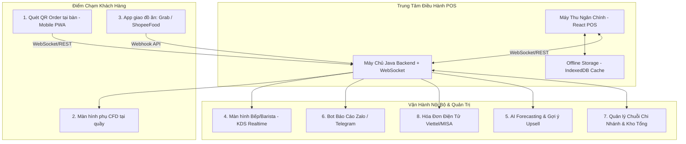
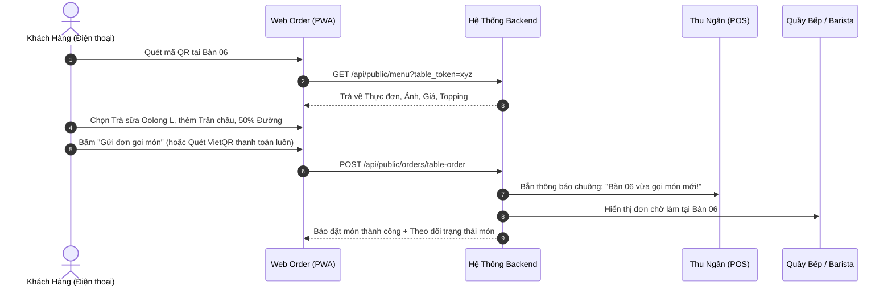
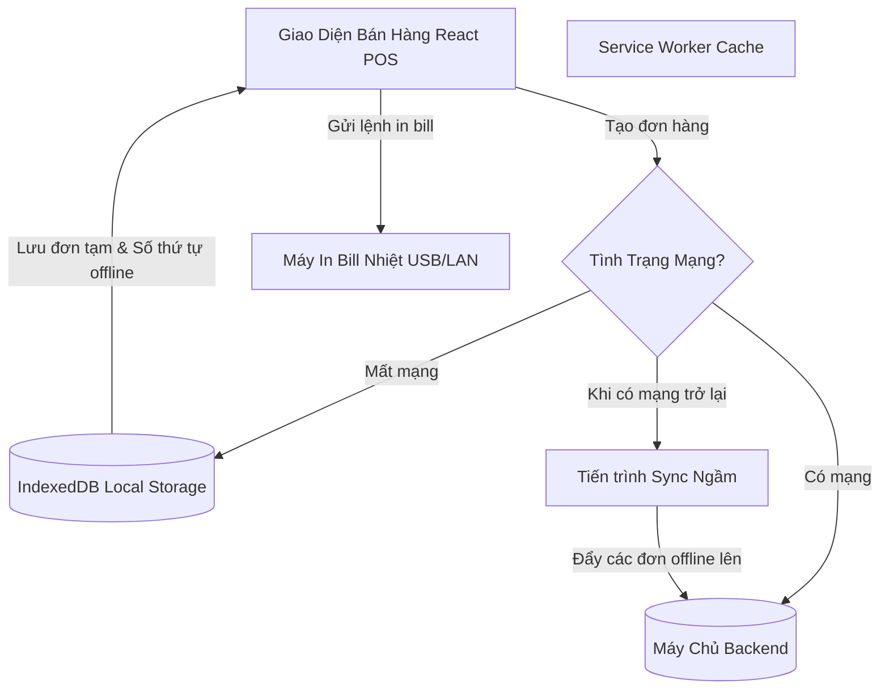

# KẾ HOẠCH NÂNG CẤP DỰ ÁN (PHẦN 2): CÁC TÍNH NĂNG ĐỘT PHÁ & CHUẨN DOANH NGHIỆP
## Enterprise, Smart AI & Omnichannel POS Architecture

> **Dự án:** Quản Lý Bán Hàng (QuanLyBanHang-Java)  
> **Tài liệu tham chiếu:** [UPGRADE_PLAN.md](file:///c:/Projects/QuanLyBanHang-Java/UPGRADE_PLAN.md) (Phần 1: Sửa lỗi, bảo mật, tối ưu POS, BOM định lượng kho & ca làm)  
> **Mục tiêu Phần 2:** Đưa hệ thống lên tầm vóc của các phần mềm thương mại hiện đại hàng đầu (*KiotViet, iPOS, Sapo, Square, Toast POS*), tích hợp tự phục vụ QR, KDS màn hình bếp, màn hình phụ CFD, AI thông minh, bán hàng Offline và quản lý chuỗi đa chi nhánh.

---

## MỤC LỤC
1. [TỔNG QUAN KIẾN TRÚC MỞ RỘNG (PHẦN 2)](#1-tổng-quan-kiến-trúc-mở-rộng-phần-2)
2. [MODULE 1: TỰ PHỤC VỤ TẠI BÀN QUA QR CODE (SELF-SERVICE DINING)](#2-module-1-tự-phục-vụ-tại-bàn-qua-qr-code-self-service-dining)
3. [MODULE 2: MÀN HÌNH HIỂN THỊ PHA CHẾ / BẾP (KITCHEN DISPLAY SYSTEM - KDS)](#3-module-2-màn-hình-hiển-thị-pha-chế--bếp-kitchen-display-system---kds)
4. [MODULE 3: MÀN HÌNH PHỤ HƯỚNG VỀ PHÍA KHÁCH HÀNG (CUSTOMER-FACING DISPLAY - CFD)](#4-module-3-màn-hình-phụ-hướng-về-phía-khách-hàng-customer-facing-display---cfd)
5. [MODULE 4: AI THÔNG MINH, DỰ BÁO NHU CẦU & BOT TỰ ĐỘNG BÁO CÁO](#5-module-4-ai-thông-minh-dự-báo-nhu-cầu--bot-tự-động-báo-cáo)
6. [MODULE 5: CHẾ ĐỘ BÁN HÀNG NGOẠI TUYẾN KHI RỚT MẠNG (OFFLINE POS MODE)](#6-module-5-chế-độ-bán-hàng-ngoại-tuyến-khi-rớt-mạng-offline-pos-mode)
7. [MODULE 6: ĐỒNG BỘ ĐƠN HÀNG SÀN GIAO ĐỒ ĂN (SHOPEEFOOD, GRABFOOD, BEFOOD)](#7-module-6-đồng-bộ-đơn-hàng-sàn-giao-đồ-ăn-shopeefood-grabfood-befood)
8. [MODULE 7: KIẾN TRÚC QUẢN LÝ CHUỖI ĐA CHI NHÁNH (MULTI-STORE ENTERPRISE)](#8-module-7-kiến-trúc-quản-lý-chuỗi-đa-chi-nhánh-multi-store-enterprise)
9. [MODULE 8: TÍCH HỢP HÓA ĐƠN ĐIỆN TỬ MÁY TÍNH TIỀN (THÔNG TƯ 78 / NGHỊ ĐỊNH 123)](#9-module-8-tích-hợp-hóa-đơn-điện-tử-máy-tính-tiền-thông-tư-78--nghị-định-123)
10. [LỘ TRÌNH KỸ THUẬT & DANH MỤC CÔNG NGHỆ ÁP DỤNG](#10-lộ-trình-kỹ-thuật--danh-mục-công-nghệ-áp-dụng)

---

## 1. TỔNG QUAN KIẾN TRÚC MỞ RỘNG (PHẦN 2)

Hệ sinh thái bán hàng hiện đại không chỉ dừng lại ở quầy thu ngân mà là một mạng lưới giao tiếp thời gian thực (Real-time Hub) kết nối Khách hàng -> Thu ngân -> Bếp/Pha chế -> Chủ quán:



---

## 2. MODULE 1: TỰ PHỤC VỤ TẠI BÀN QUA QR CODE (SELF-SERVICE DINING)

### 2.1. Mục tiêu nghiệp vụ
- Khách tự quét mã QR trên bàn để xem menu điện tử, chọn size, topping, thanh toán và gửi đơn trực tiếp đến quầy thu ngân/bếp.
- Cắt giảm 40-60% thời gian phục vụ của nhân viên, giải quyết triệt để tình trạng quá tải giờ cao điểm.

### 2.2. Luồng hoạt động (Sequence Diagram)



### 2.3. Thiết kế CSDL mới
```sql
-- 1. Quản lý khu vực & bàn
CREATE TABLE IF NOT EXISTS khu_vuc (
    id INT AUTO_INCREMENT PRIMARY KEY,
    ten_khu_vuc VARCHAR(100) NOT NULL, -- Tầng 1, Tầng 2, Sân vườn, VIP...
    thu_tu INT DEFAULT 0
) ENGINE=InnoDB DEFAULT CHARSET=utf8mb4;

CREATE TABLE IF NOT EXISTS ban_an (
    id INT AUTO_INCREMENT PRIMARY KEY,
    khu_vuc_id INT NOT NULL,
    ten_ban VARCHAR(50) NOT NULL, -- Bàn 01, Bàn 02...
    so_cho_ngoi INT DEFAULT 4,
    trang_thai ENUM('trong', 'dang_dung_bua', 'cho_thanh_toan', 'dat_truoc') DEFAULT 'trong',
    qr_token VARCHAR(64) UNIQUE NOT NULL, -- Token bí mật định danh mã QR của bàn
    FOREIGN KEY (khu_vuc_id) REFERENCES khu_vuc(id) ON DELETE CASCADE
) ENGINE=InnoDB DEFAULT CHARSET=utf8mb4;

-- 2. Phiên gọi món tại bàn (Session Order)
CREATE TABLE IF NOT EXISTS phien_order_ban (
    id INT AUTO_INCREMENT PRIMARY KEY,
    ban_id INT NOT NULL,
    gio_mo DATETIME DEFAULT CURRENT_TIMESTAMP,
    gio_dong DATETIME NULL,
    tong_tien DECIMAL(15,2) DEFAULT 0,
    trang_thai ENUM('dang_mo', 'da_thanh_toan', 'da_huy') DEFAULT 'dang_mo',
    donhang_id INT NULL,
    FOREIGN KEY (ban_id) REFERENCES ban_an(id)
) ENGINE=InnoDB DEFAULT CHARSET=utf8mb4;
```

### 2.4. Cơ chế chống gian lận (Anti-Spam & Security)
- **Token mã hóa bàn (Dynamic QR Token):** Mã QR không chỉ chứa ID bàn tĩnh mà chứa một token mã hóa. Quản lý có thể "Làm mới mã QR" trên giao diện khi cần để tránh trường hợp khách chụp ảnh mã mang về nhà rồi bấm gọi món trêu quán.
- **Giới hạn bán kính vị trí (GPS Geofencing - Tùy chọn):** Yêu cầu trình duyệt điện thoại xác thực vị trí nằm trong bán kính 50m quanh quán mới cho phép đặt món.

---

## 3. MODULE 2: MÀN HÌNH HIỂN THỊ PHA CHẾ / BẾP (KITCHEN DISPLAY SYSTEM - KDS)

### 3.1. Mục tiêu nghiệp vụ
- Thay thế hoàn toàn phiếu in giấy KOT dễ ướt, dễ cháy, thất lạc.
- Đồng bộ thời gian làm món tức thì: Quầy pha chế biết món nào cần ưu tiên, món nào đã xong.

### 3.2. Thiết kế Giao diện KDS (Touch-Screen UI Layout)

```
+--------------------------------------------------------------------------------------------------+
|  KDS PHA CHẾ - TỔNG: 4 ĐƠN ĐANG ĐỢI                | Âm thanh: [BẬT] | Bộ lọc: [Tất cả món] [15:30] |
+--------------------------------------------------------------------------------------------------+
| [ĐƠN #101 - BÀN 02] (2 phút) [XANH] | [ĐƠN #102 - MANG VỀ] (8 phút) [VÀNG] | [ĐƠN #100 - BÀN 05] (14p) [ĐỎ]|
| Khách: Anh Nam                      | Khách: Chị Linh                      | ⚠️ TRỄ MÓN                      |
|-------------------------------------|--------------------------------------|---------------------------------|
| [ ] 1x Trà Đào Cam Sả (Size L)      | [ ] 2x Cà Phê Muối (Size M)          | [ ] 2x Trà Sữa Oolong (Size L)  |
|     * Ít ngọt, nhiều đá             |     * Uống tại chỗ                   |     * 50% Đường, 70% Đá         |
| [ ] 1x Bạc Xỉu Đá (Size M)          | [ ] 1x Bánh Croissant (Hâm nóng)     |     * Thêm trân châu đen        |
|                                     |                                      | [X] 1x Nước Cam Ép              |
|-------------------------------------|--------------------------------------|---------------------------------|
| [BẮT ĐẦU LÀM]     [ĐÃ XONG MÓN]     | [BẮT ĐẦU LÀM]      [ĐÃ XONG MÓN]     | [LÀM LẠI]       [HOÀN THÀNH HẾT]|
+--------------------------------------------------------------------------------------------------+
```

### 3.3. Cơ chế kỹ thuật (Real-time WebSockets)
- Sử dụng **WebSocket (`/ws/kitchen`)** hoặc **Server-Sent Events (SSE)**.
- Khi một đơn hàng mới được tạo từ Thu ngân hoặc Khách quét QR:
  - Máy chủ gửi payload JSON đơn hàng đến tất cả màn hình KDS đang kết nối.
  - Trình duyệt tự động phát âm thanh thông báo *"Ting ting!"* (Audio Web API).
- Khi Barista bấm nút **[ĐÃ XONG MÓN]**:
  - Gửi sự kiện `item_completed(order_id, item_id)` về server.
  - Server cập nhật trạng thái món và bắn thông báo về màn hình POS của thu ngân hoặc điện thoại của khách: *"Món của bạn đã sẵn sàng tại quầy nhận!"*.

---

## 4. MODULE 3: MÀN HÌNH PHỤ HƯỚNG VỀ PHÍA KHÁCH HÀNG (CUSTOMER-FACING DISPLAY - CFD)

### 4.1. Mục tiêu nghiệp vụ
- Tăng tính chuyên nghiệp, minh bạch 100% về giá trị đơn hàng và số tiền thối lại.
- Tự động hiển thị mã **VietQR động** toàn màn hình khi thanh toán, khách quét thanh toán tức thì trong 3 giây.
- Tận dụng thời gian rảnh rỗi giữa các đơn hàng để quảng cáo sản phẩm mới, combo tiết kiệm.

### 4.2. Kiến trúc Dual-Screen không cần dây nối phức tạp
- Không cần card màn hình rời hay kéo dây HDMI phức tạp.
- Màn hình phụ CFD có thể là một chiếc máy tính bảng hoặc màn hình phụ mở trình duyệt web truy cập URL: `http://pos.local/cfd`.
- **Đồng bộ bằng BroadcastChannel API hoặc WebSockets:**
  - Khi thu ngân thao tác thêm sản phẩm trên màn hình chính -> Sự kiện `cart_updated` được phát ra ngay lập tức.
  - Màn hình CFD nhận sự kiện và render giỏ hàng song song theo thời gian thực (độ trễ < 20ms).

```
+-----------------------------------------------------------------------+
|                       QUÁN CAFE CHILL GUYS                            |
|                 Cảm ơn quý khách đã ghé thăm!                         |
+-------------------------------------+---------------------------------+
| CHI TIẾT ĐƠN HÀNG                   | QUÉT MÃ VIETQR ĐỂ THANH TOÁN    |
|                                     |                                 |
| 1. Cà Phê Muối (L)        35.000đ   |         +-------------+         |
| 2. Trà Sữa Oolong (L)     45.000đ   |         |  [ QR CODE  |         |
|    - Trân châu đen        +5.000đ   |         |    VIETQR   |         |
| 3. Bánh Sừng Bò           25.000đ   |         |   DYNAMICS  |         |
|-------------------------------------|         +-------------+         |
| Tạm tính:                110.000đ   | Ngân hàng: MB Bank              |
| Giảm giá (VIP 10%):      -11.000đ   | Số tiền: 99.000 VNĐ             |
|                                     | Nội dung: HD1024                |
| TỔNG THANH TOÁN:         99.000đ    |                                 |
+-------------------------------------+---------------------------------+
| [Banner Quảng Cáo: Mua 2 tặng 1 vào Thứ 4 hàng tuần - Chill thả ga!]   |
+-----------------------------------------------------------------------+
```

---

## 5. MODULE 4: AI THÔNG MINH, DỰ BÁO NHU CẦU & BOT TỰ ĐỘNG BÁO CÁO

### 5.1. AI Dự báo tiêu thụ nguyên liệu (Demand & Inventory Forecasting)
* **Nguyên lý:** Phân tích dữ liệu lịch sử bán hàng theo chuỗi thời gian (Time-Series Analysis), kết hợp trọng số ngày trong tuần và mùa vụ.
* **Đầu ra AI gợi ý:**
  - *"Dự báo ngày mai (Thứ 7): Cần chuẩn bị 8.5kg hạt cà phê, 22 lít sữa đặc, 150 ly giấy Size L."*
  - *"Cảnh báo: Tốc độ tiêu thụ Siro Đào đang tăng 150% trong 3 ngày qua, kho chỉ còn đủ dùng trong 1.5 ngày tới. Gợi ý tạo phiếu nhập 10 chai Siro ngay hôm nay!"*

### 5.2. Công cụ gợi ý bán kèm tự động (AI Cross-Selling Engine)
- Sử dụng thuật toán khai phá tập phổ biến (Association Rule Mining / Apriori Algorithm) từ các hóa đơn cũ:
  - Nếu hóa đơn có `Cà phê muối` -> 68% khách sẽ gọi thêm `Bánh ngọt / Hướng dương`.
  - Trên màn hình POS, hệ thống sẽ tự động hiển thị gợi ý thông minh một chạm cho thu ngân: **"Mời khách dùng thêm Bánh Croissant chỉ +20.000đ?"**.

### 5.3. Bot Telegram / Zalo OA Tự Động Báo Cáo Doanh Thu Mỗi Ngày
* **Cơ chế:** Một cron job nội bộ chạy lúc 22:30 mỗi tối, tự động tổng hợp số liệu và gọi webhook Telegram Bot API / Zalo ZNS:
* **Mẫu tin nhắn tự động gửi đến điện thoại Chủ Quán:**

```markdown
🏪 BÁO CÁO KINH DOANH NGÀY 26/10/2026 - CHILL GUYS CAFE
-----------------------------------------------------
💰 Tổng doanh thu: 14.850.000 VNĐ (+12% so với hôm qua)
🧾 Tổng đơn hoàn thành: 168 đơn (Đơn trung bình: 88.400đ)
💵 Tiền mặt: 6.200.000đ | 💳 Chuyển khoản QR: 8.650.000đ

🏆 TOP 3 SẢN PHẨM BÁN CHẠY NHẤT:
1. Cà Phê Muối: 62 ly (2.170.000đ)
2. Trà Sữa Oolong Nướng: 48 ly (2.160.000đ)
3. Trà Đào Cam Sả: 35 ly (1.400.000đ)

⚠️ CẢNH BÁO KHO NGUYÊN LIỆU:
• Cà phê hạt Robusta: Còn 1.8 kg (Dưới mức tối thiểu 3kg)
• Lô sữa chua L04: Sẽ hết hạn vào ngày 28/10 (còn 2 ngày)

✅ Thu ngân Ca 1 & Ca 2 đã kết ca, khớp quỹ 100%.
```

---

## 6. MODULE 5: CHẾ ĐỘ BÁN HÀNG NGOẠI TUYẾN KHI RỚT MẠNG (OFFLINE POS MODE)

### 6.1. Vấn đề thực tế
Khi mạng Internet bị ngắt kết nối (đứt cáp quang, sự cố nhà mạng), 90% phần mềm web bị tê liệt, khách đứng chờ đông đúc, quán mất doanh thu và hình ảnh chuyên nghiệp.

### 6.2. Kiến trúc giải pháp Offline-First (PWA + IndexedDB)



1. **Bộ đệm tài nguyên (Service Worker Cache):** Tải toàn bộ HTML, JS, CSS, Font và danh mục sản phẩm vào bộ nhớ máy khách. Khi mất mạng, F5 tải lại trang POS vẫn mở lên tức thì.
2. **Lưu trữ đơn hàng ngoại tuyến (Dexie.js / IndexedDB):** Khi mất mạng, đơn hàng được mã hóa lưu trữ an toàn trong IndexedDB của trình duyệt với tiền tố `OFFLINE-{timestamp}`.
3. **In hóa đơn Offline:** Máy tính vẫn in bill qua cổng USB máy in bình thường.
4. **Cơ chế tự động đồng bộ (Background Auto-Sync):**
   - Trình duyệt lắng nghe sự kiện `window.addEventListener('online', ...)`.
   - Ngay khi có mạng trở lại, hệ thống tự động đẩy các đơn hàng offline lên máy chủ theo thứ tự FIFO, tự động kiểm tra trừ kho và ghi nhận doanh thu mà không cần thu ngân can thiệp.

---

## 7. MODULE 6: ĐỒNG BỘ ĐƠN HÀNG SÀN GIAO ĐỒ ĂN (SHOPEEFOOD, GRABFOOD, BEFOOD)

### 7.1. Thực trạng hiện nay
Các quán thường phải để 3 chiếc điện thoại/máy POS của 3 sàn khác nhau:
- Nhân viên phải gõ lại đơn từ điện thoại Grab/Shopee vào máy POS quán để trừ kho và in bill.
- Tốn công sức, dễ nhầm lẫn sai món, và kho không kiểm soát được.

### 7.2. Giải pháp tích hợp tập trung (Omnichannel Hub)
- Xây dựng cổng tiếp nhận Webhook: `POST /api/integrations/delivery-webhook`.
- **Cơ chế đồng bộ 2 chiều:**
  1. *Nhận đơn:* Đơn nổ trên ShopeeFood/GrabFood -> Tự động chuyển thành đơn hàng trên hệ thống POS với nguồn `nguon_don = 'shopeefood'` -> Tự động in hóa đơn pha chế cho Barista.
  2. *Đồng bộ kho & Thực đơn:* Khi kho của quán hết nguyên liệu món Trà Dâu -> POS tự động gửi lệnh "Tạm ngừng bán món Trà Dâu" lên ShopeeFood/GrabFood, tránh tình trạng khách đặt nhưng quán không có hàng để giao.

---

## 8. MODULE 7: KIẾN TRÚC QUẢN LÝ CHUỖI ĐA CHI NHÁNH (MULTI-STORE ENTERPRISE)

### 8.1. Thiết kế CSDL chuỗi chi nhánh
```sql
-- 1. Danh mục chi nhánh
CREATE TABLE IF NOT EXISTS chi_nhanh (
    id INT AUTO_INCREMENT PRIMARY KEY,
    ma_chi_nhanh VARCHAR(20) UNIQUE NOT NULL, -- CN01, CN02...
    ten_chi_nhanh VARCHAR(150) NOT NULL,
    dia_chi VARCHAR(255) NOT NULL,
    so_dien_thoai VARCHAR(20) NOT NULL,
    trang_thai ENUM('hoat_dong', 'tam_dung', 'dong_cua') DEFAULT 'hoat_dong',
    la_kho_tong BOOLEAN DEFAULT FALSE,
    ngay_tao DATETIME DEFAULT CURRENT_TIMESTAMP
) ENGINE=InnoDB DEFAULT CHARSET=utf8mb4;

-- 2. Tồn kho riêng biệt theo từng chi nhánh
CREATE TABLE IF NOT EXISTS kho_chi_nhanh (
    id INT AUTO_INCREMENT PRIMARY KEY,
    chi_nhanh_id INT NOT NULL,
    nguyenlieu_id INT NOT NULL,
    so_luong_ton DECIMAL(12, 4) DEFAULT 0,
    ton_toi_thieu DECIMAL(12, 4) DEFAULT 5,
    FOREIGN KEY (chi_nhanh_id) REFERENCES chi_nhanh(id),
    FOREIGN KEY (nguyenlieu_id) REFERENCES nguyen_vat_lieu(id),
    UNIQUE KEY uk_kho_chinhanh (chi_nhanh_id, nguyenlieu_id)
) ENGINE=InnoDB DEFAULT CHARSET=utf8mb4;

-- 3. Phiếu điều chuyển hàng hóa nội bộ (Inter-Branch Transfer)
CREATE TABLE IF NOT EXISTS phieu_chuyen_kho (
    id INT AUTO_INCREMENT PRIMARY KEY,
    ma_phieu VARCHAR(40) UNIQUE NOT NULL,
    tu_chi_nhanh_id INT NOT NULL,
    den_chi_nhanh_id INT NOT NULL,
    nguoi_tao_id INT NOT NULL,
    ngay_chuyen DATETIME DEFAULT CURRENT_TIMESTAMP,
    trang_thai ENUM('cho_xac_nhan', 'dang_van_chuyen', 'da_nhan', 'da_huy') DEFAULT 'cho_xac_nhan',
    ghi_chu VARCHAR(255) NULL,
    FOREIGN KEY (tu_chi_nhanh_id) REFERENCES chi_nhanh(id),
    FOREIGN KEY (den_chi_nhanh_id) REFERENCES chi_nhanh(id)
) ENGINE=InnoDB DEFAULT CHARSET=utf8mb4;
```

### 8.2. Báo cáo so sánh chi nhánh (Multi-Branch Analytics)
- Báo cáo biểu đồ so sánh: Doanh thu, chi phí nguyên liệu và tỷ suất lợi nhuận giữa các chi nhánh trên cùng một trang tổng quan.
- Phân quyền theo chi nhánh: Nhân viên và cửa hàng trưởng chỉ xem được số liệu của chi nhánh mình; Chủ tịch/Giám đốc chuỗi xem toàn quyền mọi chi nhánh.

---

## 9. MODULE 8: TÍCH HỢP HÓA ĐƠN ĐIỆN TỬ MÁY TÍNH TIỀN (THÔNG TƯ 78 / NGHỊ ĐỊNH 123)

### 9.1. Yêu cầu pháp lý tại Việt Nam
Theo quy định hiện hành của Tổng cục Thuế, các cơ sở kinh doanh dịch vụ ăn uống, nhà hàng, bán lẻ thuộc diện triển khai **Hóa đơn điện tử khởi tạo từ máy tính tiền** có kết nối chuyển dữ liệu điện tử với cơ quan thuế.

### 9.2. Luồng tích hợp API Hóa Đơn Điện Tử (E-Invoice Connector)
- Hệ thống xây dựng lớp tích hợp dùng chung `EInvoiceService` hỗ trợ các nhà cung cấp phổ biến tại Việt Nam:
  - **Viettel S-Invoice**
  - **VNPT Invoice**
  - **MISA meInvoice**
- **Quy trình xuất hóa đơn:**
  1. Khi thanh toán đơn hàng có xuất hóa đơn GTGT: POS tự động gửi payload JSON đơn hàng sang cổng của nhà cung cấp HĐĐT qua REST API.
  2. Nhà cung cấp cấp mã cơ quan thuế và trả về URL xem hóa đơn + Mã tra cứu.
  3. Máy in POS tự động in mã QR tra cứu hóa đơn điện tử ở chân bill để khách hàng tự quét lấy hóa đơn đỏ VAT hợp pháp.

---

## 10. LỘ TRÌNH KỸ THUẬT & DANH MỤC CÔNG NGHỆ ÁP DỤNG

Để hiện thực hóa các module đột phá trên, đây là danh mục các công nghệ và thư viện khuyến nghị tích hợp:

| Hạng mục | Công nghệ khuyến nghị | Mục đích sử dụng |
|---|---|---|
| **Realtime Communication** | **WebSocket (Jakarta WebSocket / Spring STOMP)** | Đẩy dữ liệu thời gian thực cho KDS bếp, màn hình phụ CFD và thông báo đơn mới tức thì. |
| **Offline POS Storage** | **Dexie.js (IndexedDB Wrapper) + Service Workers** | Lưu trữ đơn hàng, danh mục sản phẩm và đồng bộ ngầm khi rớt mạng. |
| **Frontend UI/UX** | **Tailwind CSS + Headless UI + Lucide Icons** | Xây dựng giao diện POS, KDS và CFD hiện đại, chuẩn cảm ứng đa điểm. |
| **Data Visualizations** | **ApexCharts.js** | Hiển thị biểu đồ phân tích kinh doanh, dự báo xu hướng doanh thu và chi phí. |
| **AI Integration** | **Google Gemini Flash API** | Trợ lý phân tích dữ liệu, tự động viết báo cáo tóm tắt kinh doanh và gợi ý bán kèm. |
| **Messaging & Alerting** | **Telegram Bot API / Zalo ZNS SDK** | Tự động gửi báo cáo doanh thu và cảnh báo kho nguyên liệu hàng ngày vào điện thoại chủ quán. |
| **Payment Gateway** | **SePay Webhook / VietQR Pro** | Tự động xác nhận giao dịch ngân hàng không cần thu ngân kiểm tra điện thoại. |

---

*Tài liệu này là phần kế tiếp mở rộng của [UPGRADE_PLAN.md](file:///c:/Projects/QuanLyBanHang-Java/UPGRADE_PLAN.md). Toàn bộ 8 module trên được thiết kế theo dạng module hóa độc lập (Plug-and-Play), có thể kích hoạt từng phần tùy theo nhu cầu và ngân sách phát triển của quán.*
