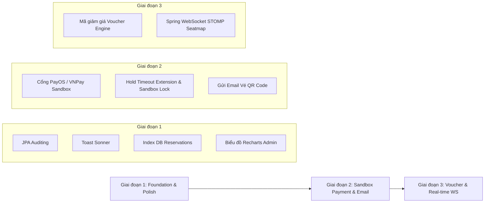

# Kế hoạch nâng cấp hệ thống bán vé xem phim (CineVe) — 3 Giai đoạn

> **Tệp tài liệu kỹ thuật nâng cấp chính thức**
> Bám sát kiến trúc hệ thống hiện tại: Một cụm rạp, hai kênh bán vé (`ONLINE` cho Khách hàng & `POS` cho Thu ngân tại quầy), chung kho ghế và sơ đồ ghế thời gian thực, giữ ghế 8 phút, khóa Unique DB `(showtime_id, seat_id)`, khóa hàng suất chiếu `PESSIMISTIC_WRITE`, soát vé một lần.

---

## 🎯 QUY TẮC CỐ ĐỊNH (NON-NEGOTIABLE CONSTRAINTS)

Tất cả các giai đoạn nâng cấp **tuyệt đối không làm thay đổi hay phá vỡ** các quy tắc nghiệp vụ cốt lõi đã chốt:

1. **Cửa sổ bán vé**:
   - Khách (`ONLINE`): Không được giữ ghế mới khi suất chiếu đã chạm mốc `startAt`.
   - Quầy (`POS`): Thu ngân được phép bán vé sau `startAt` cho đến khi chạm mốc `endAt` (`startAt` + thời lượng phim + 15 phút dọn phòng).
2. **Trạng thái Suất chiếu**:
   - Hủy suất chiếu đặt trạng thái = `CANCELLED`.
   - Suất chiếu đã có vé đã thanh toán (`HAS_TICKETS`) hoặc đang có ghế giữ (`HAS_HOLDS`) **không được phép sửa hoặc hủy**.
3. **Phân kênh Thanh toán**:
   - Quầy `POS` giữ nguyên phương thức thu tiền mặt (`confirmCash`).
   - Cổng thanh toán trực tuyến (Sandbox) chỉ áp dụng riêng cho kênh `ONLINE`.
4. **Phạm vi hạ tầng**:
   - Không đa rạp, không phân loại 2D/3D, không sử dụng Redis.
   - WebSocket ở Giai đoạn 3 chỉ đóng vai trò cập nhật giao diện (visual rendering), **DB Transaction + Unique Constraint vẫn là trọng tài duy nhất** giải quyết tranh chấp ghế.

---

## 📅 NỘI DUNG NÂNG CẤP CHI TIẾT THEO GIAI ĐOẠN



---

## 🟢 GIAI ĐOẠN 1: NỀN TẢNG & TỐI ƯU HÓA (FOUNDATION & POLISH)

**Mục tiêu**: Đảm bảo toàn bộ luồng đặt vé hiện tại chạy ổn định, bổ sung ghi vết dữ liệu (Auditing), nâng cấp phản hồi giao diện (Toast Notifications), tối ưu tốc độ truy vấn DB (Indexing) và trực quan hóa báo cáo doanh thu đã có.

### 1. Kích hoạt JPA Auditing (Data Traceability)
- **Cấu hình Spring Boot**: Thêm `@EnableJpaAuditing` tại `VexemphimApplication` và khai báo `@EntityListeners(AuditingEntityListener.class)` trên các Entity.
- **Các Entity áp dụng**: `Reservation`, `Payment`, `Ticket`, `Showtime`, `Movie`, `User`.
- **Cấu trúc trường dữ liệu**:
  - Tận dụng trường `created_at` sẵn có (gắn thêm `@CreatedDate`).
  - Bổ sung trường `updated_at` (gắn `@LastModifiedDate`).
  - *Lưu ý*: Không tạo cột `created_by` trong pha này vì đơn đặt vé đã lưu trữ sẵn `customerUserId` / `cashierUserId`. Không áp dụng Auditing lên `ReservationSeat` vì bảng này xóa/chèn liên tục theo vòng đời giữ chỗ.

### 2. Tích hợp Toast Notification (Thư viện `sonner`)
- **Cài đặt**: Tích hợp `sonner` vào Frontend React Client, đặt component `<Toaster position="top-right" richColors />` tại root ứng dụng (`App.tsx`).
- **Kịch bản bắn Toast**:
  - *Hành động Auth*: Đăng nhập sai mật khẩu (`401`), Đăng ký trùng username (`400`).
  - *Hành động Booking*: Giữ ghế trùng (`409 SEAT_TAKEN`), Hết hạn giữ chỗ (`409 HOLD_EXPIRED`), Suất chiếu đóng (`400 SHOWTIME_CLOSED`), Thanh toán thành công, Hủy giữ chỗ.
  - *Hành động Check-in POS*: Soát vé thành công, Vé đã soát trước đó (`409 ALREADY_CHECKED_IN`), Vé chưa thanh toán (`400 NOT_PAID`).
  - *Hành động Admin*: Thêm/sửa phim, suất chiếu, phòng thành công hoặc thất bại (`409 SHOWTIME_OVERLAP`, `HAS_TICKETS`, `HAS_HOLDS`).
- **Quy tắc quan trọng**: Polling sơ đồ ghế 5 giây **không bắn toast** khi nhận lỗi background; chỉ cập nhật trạng thái ô ghế để tránh gây quấy rầy người dùng.

### 3. Tối ưu Index Database (`reservations`)
Bảng `reservation_seats` đã có Unique Index `(showtime_id, seat_id)`. Bổ sung các `@Index` sau tại Entity `Reservation` để Hibernate / MySQL tự động tạo index:

| Tên Index đề xuất | Cặp cột (Columns) | Phục vụ cho Query trong Backend |
|---|---|---|
| `idx_res_status_expires` | `(status, hold_expires_at)` | `HoldExpiryScheduler`: Tìm các hold quá hạn để dọn dẹp |
| `idx_res_st_cust_status` | `(showtime_id, customer_user_id, status)` | `findMyOpenHold`: Kiểm tra giữ ghế mở kênh Online |
| `idx_res_st_cash_status` | `(showtime_id, cashier_user_id, status)` | `findMyOpenHold`: Kiểm tra giữ ghế mở kênh POS |
| `idx_res_cust_status_created` | `(customer_user_id, status, created_at)` | `GET /api/bookings/my`: Lấy lịch sử vé của khách |

### 4. Biểu đồ Doanh thu trực quan (Recharts Dashboard)
- Giữ nguyên API `GET /api/reports/revenue` hiện tại trong `ReportService.java`.
- Cập nhật trang `ReportAdminPage.tsx`: Thay các cột phần trăm HTML/CSS thủ công bằng component `<ResponsiveContainer>` & `<BarChart>` từ thư viện **Recharts**.
- Hiển thị cột chồng (Stacked Bar Chart): Màu vàng biểu thị doanh thu Vé Phim, màu xanh biểu thị doanh thu Bắp Nước theo từng nấc thời gian (`DAY`, `WEEK`, `MONTH`).

---

## 🟡 GIAI ĐOẠN 2: THANH TOÁN ONLINE SANDBOX & VÉ ĐIỆN TỬ (PAYMENT & EMAIL)

**Mục tiêu**: Tích hợp cổng thanh toán trực tuyến Sandbox (PayOS / VNPay) cho khách hàng Online, xử lý Webhook an toàn, tự động gửi Email xác nhận kèm QR Code soát vé.

### 1. Tích hợp Cổng thanh toán Sandbox (PayOS / VNPay)
- **Đối tượng áp dụng**: Kênh `ONLINE` duy nhất. Kênh `POS` giữ nguyên luồng `confirmCash`.
- **Luồng xử lý (Payment Flow)**:
  1. Khách hàng bấm **Thanh toán**: Client gửi `POST /api/bookings/{id}/create-payment-link`.
  2. Backend kiểm tra điều kiện Hold, tạo bản ghi `Payment` (`status = PENDING`, `method = PAYOS` hoặc `VNPAY`, `amount = totalAmount`).
  3. Backend gọi SDK/REST API của cổng thanh toán sandbox để lấy `checkoutUrl` / `qrCode` trả về cho Client.
  4. Trình duyệt chuyển hướng hoặc hiển thị QR chuyển khoản sandbox.
  5. **Bảo mật Webhook (IPN Callback)**:
     - Webhook Controller tại `/api/payments/webhook` tiếp nhận kết quả từ cổng thanh toán.
     - **Bắt buộc kiểm tra chữ ký HMAC-SHA256** với Secret Key cấu hình trong `application.properties`.
     - Kiểm tra **Idempotency**: Nếu `Payment` tương ứng đã ở trạng thái `SUCCESS`, trả về HTTP 200 OK ngay lập tức, không xử lý lại.
     - Nếu chữ ký hợp lệ và giao dịch thành công: Gọi `finalizePayment(res, method)` để chuyển `Reservation` -> `CONFIRMED`, sinh mã vé `ticket_code` và xóa `holdExpiresAt`.

### 2. Quy tắc Quản lý Giữ ghế trong thời gian chờ thanh toán (Hold Expiry Buffer)
- Khi bản ghi `Payment` trạng thái `PENDING` được tạo, hệ thống nới rộng `holdExpiresAt` thêm thời gian chờ cổng (ví dụ: +10 phút, cấu hình `app.payment-wait-minutes=10`).
- **Xử lý trễ hạn (Late Payment Handling)**:
  - Nếu khách thanh toán sau khi `holdExpiresAt` đã bị `HoldExpiryScheduler` quét xóa: Ghế đã bị nhả.
  - Webhook nhận thông báo thành công nhưng phát hiện `Reservation` đã bị `EXPIRED`: Cập nhật `Payment.status = LATE_PAYMENT`. **Không tạo vé**, **không phục hồi ghế**. Hiển thị thông báo trên Web cho khách hàng biết giao dịch quá hạn và cần liên hệ CSKH.

### 3. Gửi Email Vé Điện Tử & Mã QR Soát Vé
- **Bổ sung dữ liệu**: Thêm cột `email` (Unique, Not Null) vào bảng `users` và DTO `RegisterRequest`.
- **Tích hợp Spring Mail**: Sử dụng `spring-boot-starter-mail` + HTML Template (Thymeleaf/Inline HTML).
- **Thời điểm gửi**: Ngay sau khi `finalizePayment` hoàn tất thành công cho đơn `ONLINE` và khách hàng có email hợp lệ.
- **Nội dung Email**:
  - Thông tin phim, suất chiếu, phòng chiếu, danh sách ghế, tổng tiền.
  - Mã vé dạng văn bản (`ticket_code`, ví dụ: `VX-2026-000101`).
  - Hình ảnh QR Code được tạo động (Data URL PNG Base64). Payload của QR Code là **chính xác mã `ticket_code`**.
- **Soát vé**: Thu ngân tại quầy dùng trang `/pos/check-in` quét camera hoặc nhập mã `ticket_code` để gọi `POST /api/tickets/{code}/check-in`.

---

## 🔴 GIAI ĐOẠN 3: MÃ GIẢM GIÁ & SƠ ĐỒ GHẾ REAL-TIME (VOUCHER & WEBSOCKET)

**Mục tiêu**: Cung cấp tính năng Mã giảm giá (Voucher) kích thích mua vé và nâng cấp Sơ đồ ghế cập nhật thời gian thực bằng Spring WebSocket STOMP.

### 1. Hệ thống Mã Giảm Giá (Voucher Engine)
- **Bảng CSDL `vouchers`**:
  - `id`, `code` (Unique, ví dụ: `CINE20`), `discount_type` (`AMOUNT` hoặc `PERCENT`), `discount_value`, `min_order_amount`, `max_discount_amount`, `usage_limit`, `used_count`, `start_at`, `end_at`, `status` (`ACTIVE`/`INACTIVE`).
- **Luồng áp dụng Voucher**:
  - Khách nhập mã tại trang Checkout: Client gọi `POST /api/bookings/{id}/apply-voucher`.
  - Backend xác thực điều kiện: Mã còn hạn, còn lượt (`used_count < usage_limit`), tổng đơn đạt `min_order_amount`.
  - Ghi nhận `voucher_code` và `discount_amount` lên `Reservation`. Tính toán lại `total_amount = (seats + concessions) - discount_amount`.
- **Bảo mật & Tranh chấp lượt dùng**:
  - Số lượt `used_count` **chỉ thực sự tăng (increment)** trong DB Transaction của `finalizePayment` khi thanh toán thành công.
  - Sử dụng câu lệnh Atomic Update DB:
    ```sql
    UPDATE vouchers SET used_count = used_count + 1 WHERE id = :id AND used_count < usage_limit
    ```
  - Nếu lúc thanh toán voucher đã hết lượt, hệ thống trả về mã lỗi `VOUCHER_LIMIT_REACHED` và yêu cầu thanh toán đủ tiền gốc.

### 2. Sơ Đồ Ghế Thời Gian Thực (Spring WebSocket STOMP)
- **Cấu hình WebSocket Backend**:
  - Sử dụng `spring-boot-starter-websocket`.
  - Endpoint kết nối: `/ws-cineve`. Message Broker Topic: `/topic/showtimes/{showtimeId}`.
- **Cơ chế phát tin (Event Broadcasting)**:
  - Mỗi khi xảy ra sự kiện: `HOLD` ghế thành công, `CANCEL` giữ chỗ, `EXPIRE` dọn ghế, hoặc `CONFIRMED` thanh toán.
  - `BookingService` phát một Event Payload nhẹ chứa danh sách các ghế vừa thay đổi trạng thái:
    ```json
    {
      "showtimeId": 105,
      "updatedSeats": [
        { "seatId": 12, "status": "HOLD" },
        { "seatId": 13, "status": "HOLD" }
      ]
    }
    ```
- **Xử lý phía React Client**:
  - Màn hình `SeatMapPage` subscribe vào topic của `showtimeId` tương ứng.
  - Khi nhận được tin nhắn WebSocket, Client chỉ cập nhật lại state của đúng các ô ghế bị thay đổi.
  - Vẫn giữ Polling 5 giây làm cơ chế dự phòng (fallback) phòng trường hợp đứt kết nối mạng/WebSocket.
- **Trọng tài duy nhất**:
  - WebSocket chỉ phục vụ hiển thị mượt mà. Quyết định ai giữ được ghế vẫn phụ thuộc vào Database Transaction với `PESSIMISTIC_WRITE` và Unique Constraint `(showtime_id, seat_id)`. Bấm sau vẫn nhận lỗi `409 SEAT_TAKEN`.

---

## 📑 BẢNG TỔNG HỢP MÃ LỖI VÀ XỬ LÝ (ERROR CODE CONTRACTS)

| Mã lỗi HTTP | Code trả về | Nguyên nhân | Phản hồi giao diện (Toast / Notification) |
|---|---|---|---|
| `409 CONFLICT` | `SEAT_TAKEN` | Ghế đã có người khác giữ hoặc mua trước | ⚠️ "Ghế này vừa có người chọn. Vui lòng chọn ghế khác!" |
| `409 CONFLICT` | `HOLD_EXPIRED` | Đã hết 8 phút giữ chỗ hoặc hết thời gian chờ cổng | ⏰ "Thời gian giữ ghế đã hết. Vui lòng chọn lại ghế!" |
| `400 BAD_REQUEST` | `SHOWTIME_CLOSED` | Suất chiếu đã bắt đầu (kênh Online) hoặc đã kết thúc | 🚫 "Suất chiếu này đã đóng bán vé!" |
| `400 BAD_REQUEST` | `CONCESSION_HIDDEN` | Món bắp/nước đã ngừng kinh doanh | 🍿 "Sản phẩm bắp nước hiện không còn bán!" |
| `400 BAD_REQUEST` | `VOUCHER_INVALID` | Mã giảm giá không tồn tại hoặc hết hạn | 🏷️ "Mã giảm giá không hợp lệ hoặc đã hết hạn!" |
| `409 CONFLICT` | `VOUCHER_LIMIT_REACHED` | Mã giảm giá vừa hết lượt sử dụng | 🏷️ "Mã giảm giá đã hết lượt sử dụng!" |
| `409 CONFLICT` | `ALREADY_CHECKED_IN` | Vé đã được soát trước đó | 🔴 "CẢNH BÁO: Vé này đã soát vào rạp trước đó!" |

---

## 🚫 CÁC TÍNH NĂNG CỐ Ý KHÔNG ĐƯA VÀO PHẠM VI DỰ ÁN

Để đảm bảo dự án tập trung vào tính khả thi, đúng tiến độ bài tập lớn / đồ án, các tính năng sau **không thuộc phạm vi phát triển**:
1. Đa cụm rạp / chọn vị trí rạp.
2. Định dạng phim 3D/IMAX/4DX (chỉ làm chuẩn phòng 2D).
3. Hoàn vé / Hủy vé đã thanh toán trực tuyến.
4. Copy lịch chiếu cả tuần tự động.
5. Triển khai hạ tầng Redis / Kafka / Microservices độc lập.
