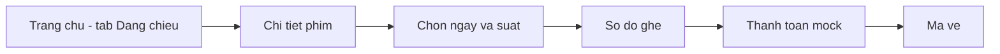

# 07. Ứng dụng client — hai kênh

Một codebase React + TypeScript + Vite (port **5173**). Không hai repo frontend. Không làm HTML thuần SOS08/09 làm client chính — thiếu POS + SeatGrid; báo cáo ghi: *cùng ý SOS08 (client tách, fetch API, CORS, localStorage role) nhưng SPA React*.

Mẫu hành vi SOS08/09: login → lưu user, chặn sai role, list có search/sort/page, admin CRUD + upload.

---

## 0. Design system — đỏ / vàng / trắng

Thương hiệu client: **CineVe** (vé in vẫn ghi “Rạp BTL”).

Tham chiếu thị trường, rút gọn cho **một rạp**: CGV (header đỏ, CTA nổi, grid poster, sơ đồ ghế có chú thích), Galaxy (tab Đang chiếu / Sắp chiếu, stepper), Lotte (Chọn suất → Ghế → Thanh toán, giới hạn ~8 ghế/giao dịch).

**Không copy:** membership/tích điểm, nhiều cụm rạp, cổng thanh toán thật, Góc điện ảnh, khuyến mãi.

Bắp nước: bước tùy chọn sau ghế, cùng một thanh toán với vé. Combo là một món có giá, không công thức.

### Token màu

Khai báo ở `:root` trong `web-client/src/index.css`. Không hard-code hex trong component.

| Token | Giá trị | Dùng ở đâu |
|---|---|---|
| `--brand-red` | `#C41E3A` | Header, logo, badge rated, viền ghế VIP, giá tiền |
| `--brand-red-dark` | `#9B1730` | Hover nền đỏ |
| `--brand-yellow` | `#F5C518` | CTA chính: Mua vé, Tiếp tục, Thanh toán, Đã thu tiền; ghế đang chọn |
| `--brand-yellow-dark` | `#D4A90F` | Hover CTA, viền ghế đang chọn |
| `--surface` | `#FFFFFF` | Nền thẻ, panel, ghế trống |
| `--bg` | `#FAF7F7` | Nền trang |
| `--ink` | `#1A1A1A` | Chữ chính |
| `--muted` | `#6B7280` | Chữ phụ, metadata |
| `--line` | `#E5E7EB` | Viền thẻ, input, divider |
| `--sold` | `#9CA3AF` | Ghế người khác đang giữ / đã bán |

Quy tắc: **đỏ = nhận diện**, **vàng = hành động**, **trắng = nền**. Không dùng đỏ cho ghế đã bán (lẫn với CTA) và không dùng vàng cho chữ trên nền trắng.

### Thành phần dùng lại

| Class | Vai trò |
|---|---|
| `.nav` | Header đỏ dính trên cùng, cao 64px |
| `.btn-yellow` / `.btn-red` / `.btn-outline` / `.btn-ghost` | Bậc hành động, CTA luôn vàng |
| `.tab` / `.tab.on` | Tab Đang chiếu / Sắp chiếu, số trang |
| `.card` + `.poster` | Thẻ phim tỉ lệ 2/3, fallback nền đỏ khi chưa có poster |
| `.badge` | Nhãn rated đỏ (P, C13, C16, C18) |
| `.stepper` / `.step.on` | 5 bước đặt vé |
| `.screen` | Thanh “MÀN HÌNH” trên lưới ghế |
| `.seat` + `.vip` `.mine` `.hold` `.booked` | Ô ghế |
| `.panel` | Khối trắng có viền cho form / chi tiết |
| `.toast` / `.toast.err` | Thông báo vàng / lỗi đỏ nhạt |
| `.price` / `.pos-price` | Tổng tiền khách (22px) / quầy (42px) |

### Ba kênh, một bộ token

- **Khách:** header đỏ, nền trắng, grid poster, CTA vàng.
- **POS:** cùng màu, chữ và nút lớn hơn, tổng tiền `.pos-price`, bỏ trang trí.
- **Admin:** cùng header, nội dung là panel trắng + form; nút Lưu vàng.

---

## 1. Cấu trúc thư mục (đã code)

```
web-client/
  .env                VITE_API_BASE_URL, VITE_API_KEY
  src/
    index.css         token màu + component class
    App.tsx           router + Navbar + footer
    api/              client.ts (axios + interceptor), authApi, catalogApi, bookingApi, types.ts
    context/          AuthContext.tsx
    components/       Navbar.tsx, SeatGrid.tsx, Protected.tsx
    pages/            HomePage, ShowtimesPage, SeatMapPage, CheckoutPage,
                      LoginPage, RegisterPage, TicketsPage
    pages/pos/        PosHomePage, PosPrintPage, PosScanPage
    pages/admin/      GenreAdminPage, MovieAdminPage, ShowtimeAdminPage
```

`SeatMapPage` và `CheckoutPage` nhận prop `channel: "ONLINE" | "POS"` nên POS không có bản sao riêng.

`.env` local:

```
VITE_API_BASE_URL=http://localhost:8080
VITE_API_KEY=SECRET_KEY_BTL
```

Token: `localStorage` `vx_token`, `vx_user` (không `crs_token`, không nhầm `currentUser` SOS nếu chạy song song).

Axios: Bearer luôn khi có token. `X-API-KEY` tự gắn cho POST/PUT/DELETE tới `/api/genres`, `/api/movies`, `/api/showtimes`.

---

## 2. Kiến trúc thông tin (IA)

Nav khách — một rạp nên **không có ô chọn cụm rạp**:

- Logo wordmark **CineVe** (chữ “Ve” vàng)
- Phim · Vé của tôi (khi login) · Đăng nhập / Đăng ký / POS
- Footer mỏng một dòng: client chỉ gọi REST `:8080`

Nav đổi theo role: CASHIER thấy Bán vé + Soát vé; ADMIN thấy Thể loại + Phim + Suất chiếu.

### Trang chủ `/`

Thay list SOS08 thuần bằng bố cục rạp:

1. Tiêu đề + mô tả ngắn
2. **Tab Đang chiếu / Sắp chiếu**
3. Ô tìm theo tên + select sắp xếp (`title,asc`, `title,desc`, `durationMinutes,desc`)
4. Grid poster: badge rated, thể loại, thời lượng
5. Phân trang số trang (`data.totalPages` — SOS07/08)

Phim `SHOWING` → nút **Mua vé** (vàng). Phim `COMING` → nút **Thông tin** (outline), không vào được luồng giữ ghế.

### Chi tiết + lịch chiếu `/showtimes/:movieId`

Panel phim (rated, thể loại, thời lượng, mô tả) + chọn ngày + giờ suất dạng chip. Phim `COMING` hiện toast “chưa mở bán vé” và **không** render danh sách suất.

Chưa đăng nhập mà bấm suất: chuyển `/login`, nhớ đích `/book/:showtimeId` để quay lại.

### Luồng đặt vé



POS đi tắt: `/pos` (suất hôm nay) → `/pos/book/:id` → `/pos/checkout/:id` → `/pos/print/:id`.

---

## 3. Định tuyến

| Path | Role | Màn hình |
|---|---|---|
| `/` | public | Danh sách phim (tab, tìm, sort, phân trang) |
| `/showtimes/:movieId` | public | Chi tiết phim + lịch chiếu |
| `/login`, `/register` | public | Khách |
| `/book/:showtimeId` | CUSTOMER | Sơ đồ ghế, channel ONLINE |
| `/checkout/:reservationId` | CUSTOMER | Đếm ngược + thanh toán mock |
| `/tickets` | CUSTOMER | Vé của tôi |
| `/pos/login` | public | Login thu ngân |
| `/pos` | CASHIER | Suất hôm nay |
| `/pos/book/:showtimeId` | CASHIER | Cùng SeatGrid, channel POS |
| `/pos/checkout/:reservationId` | CASHIER | Tiền mặt |
| `/pos/print/:reservationId` | CASHIER | Vé in `window.print` |
| `/pos/tickets` | CASHIER | Soát mã vé |
| `/admin/genres` | ADMIN | CRUD thể loại |
| `/admin/movies` | ADMIN | CRUD + upload poster |
| `/admin/showtimes` | ADMIN | Tạo suất (chặn overlap) |

`Protected` đẩy sai vai: CUSTOMER vào `/pos` → `/`; CASHIER vào `/book` → `/pos`; ADMIN → `/admin/movies`.

---

## 4. Stepper 5 bước

Hiện trên luồng khách và POS:

```
1. Phim → 2. Suất → 3. Ghế → 4. Bắp nước → 5. Thanh toán
```

| Màn | Bước sáng |
|---|---|
| `/pos` (chọn phim) | 1 |
| `/pos/movies/:id` hoặc chi tiết phim | 1, 2 |
| `/book/:showtimeId` | 1–3 |
| `/concessions/:reservationId` | 1–4 |
| `/checkout/:reservationId` | cả 5 |

Bắp nước có thể bỏ qua (PUT `items: []`). POS cùng stepper.

---

## 5. SeatGrid dùng chung

Một component cho cả hai kênh, khác nhau ở `channel` khi gọi hold:

- Online: `channel: "ONLINE"`
- POS: `channel: "POS"` (+ ô tên khách tuỳ chọn trước khi giữ)

Bố cục: thanh **MÀN HÌNH** trên cùng, mỗi hàng có nhãn chữ cái, chú thích màu dưới lưới.

| Trạng thái API | Màu | Tương tác |
|---|---|---|
| `AVAILABLE` | trắng, viền xám | chọn được |
| `AVAILABLE` + type `VIP` | trắng, **viền đỏ** | chọn được, giá × 1.2 |
| đang chọn / `HOLD_MINE` | **vàng** | bấm lại để bỏ |
| `HOLD` (người khác) | xám `--sold` | disabled |
| `BOOKED` | xám đậm | disabled |

Giới hạn **8 ghế** mỗi lần giữ (chặn ở client, backend kiểm lại). Poll seat-map **5 giây**, không WebSocket. Sau mỗi 409: gọi lại seat-map.

Thanh dưới lưới: danh sách nhãn ghế + tổng tiền `.price` + nút **Tiếp tục** (vàng, disabled khi chưa chọn).

---

## 6. Checkout online / POS

Cùng `CheckoutPage`, khác `channel`:

- **Online:** countdown từ `holdExpiresAt` (mm:ss), nút “Thanh toán giả lập” → `/tickets`.
- **POS:** `.pos-price` cỡ lớn, nút “Đã thu tiền” → trang in.

Cả hai có nút Hủy giữ chỗ (`DELETE /api/bookings/{id}` → 204).

---

## 7. Trang khách — search / sort / page

Như SOS08 `products.js`: `name`, `page`, `size`, `sort`. Đọc `data.content`, `data.totalPages`. Đổi tab hoặc đổi từ khóa thì về trang 0.

## 8. Admin — SOS09

Form phim: tên, thời lượng, rated, mô tả, select thể loại, trạng thái (`SHOWING` / `COMING` / `HIDDEN`). Lưu JSON rồi `upload-poster` nếu có file. Xóa mềm. Tạo thể loại trước khi gán phim (SOS05: Category trước Product).

Suất chiếu: chọn phim + phòng + giờ + giá; lỗi `SHOWTIME_OVERLAP` hiện toast đỏ.

## 9. Trạng thái client

Không coi localStorage là nguồn ghế. Toast cho 401, 403, 409, lỗi mạng. 401 (trừ login) → xóa token, về `/login`.

## 10. Vì sao một SPA vẫn đúng môn

Môn cần **ứng dụng khách tiêu thụ API**. Báo cáo: “Hai client logic (ONLINE và POS) trong một SPA, cùng `:8080`.”
