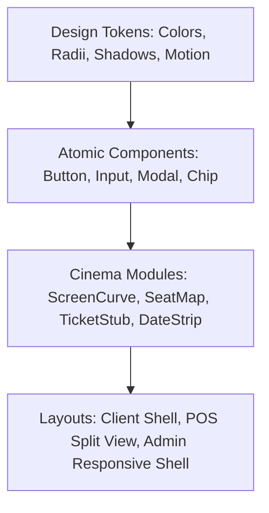
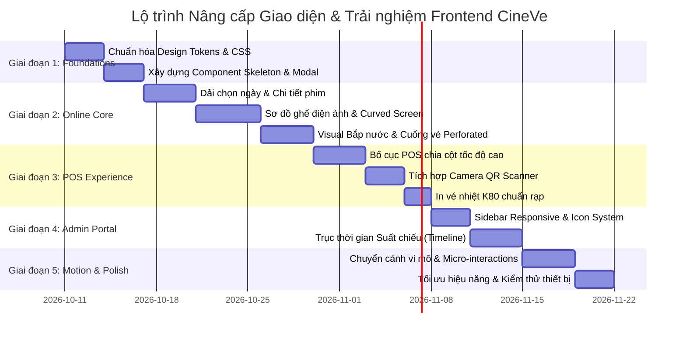

# Báo cáo Đánh giá Toàn diện UI/UX & Lộ trình Nâng cấp Frontend (CineVe)

> **Tài liệu chiến lược & kỹ thuật nâng cấp giao diện người dùng**  
> **Dự án**: Hệ thống Đặt vé xem phim CineVe (Online & POS)  
> **Mục tiêu**: Tối ưu hóa tính thẩm mỹ điện ảnh (Cinematic Visuals), dọn dẹp bố cục (Streamline Layout Clutter), đồng bộ hóa Design System và đưa vào các chuyển động vi mô (Micro-interactions) mượt mà, biến CineVe thành nền tảng đặt vé hiện đại, trực quan và đẳng cấp.

---

## 📑 MỤC LỤC
1. [Tầm nhìn & Định vị Trải nghiệm (Vision & UX Philosophy)](#1-tầm-nhìn--định-vị-trải-nghiệm)
2. [Đánh giá Toàn diện UI/UX Hiện tại (Heuristic & UX Audit)](#2-đánh-giá-toàn-diện-uiux-hiện-tại)
   - 2.1. Nền tảng thiết kế & Design Tokens
   - 2.2. Phân hệ Khách hàng Online (Customer Journey)
   - 2.3. Phân hệ Thu ngân tại quầy (POS Experience)
   - 2.4. Phân hệ Quản trị (Admin Portal)
   - 2.5. Trạng thái rỗng, Đang tải và Thông báo lỗi (Empty, Loading & Error States)
3. [Quy chuẩn Thiết kế CineVe ("CineVe Design System")](#3-quy-chuẩn-thiết-kế-cineve-cineve-design-system)
   - 3.1. Bảng màu điện ảnh (Cinematic Palette & Glassmorphism)
   - 3.2. Hệ thống Typography phân cấp
   - 3.3. Độ cong góc (Radius) & Độ bóng (Elevation Shadow Scale)
   - 3.4. Chuyển động vi mô (Motion Curves & Micro-interactions)
4. [Kế hoạch Tái cấu trúc Các Màn hình Trọng điểm (Blueprint UI Refactoring)](#4-kế-hoạch-tái-cấu-trúc-các-màn-hình-trọng-điểm)
   - 4.1. Màn hình Sơ đồ ghế (SeatMap Cinema Experience)
   - 4.2. Thanh chọn ngày chiếu dạng dải (Horizontal Date Strip Carousel)
   - 4.3. Thẻ vé điện tử dạng cuống vé đục lỗ (Perforated Ticket Stub)
   - 4.4. Chọn bắp nước kèm hình ảnh & combo ưu đãi (Concessions Visual Cards)
   - 4.5. Trải nghiệm quét mã QR camera tốc độ cao cho POS
5. [Lộ trình Triển khai Frontend Nâng cấp (5 Giai đoạn)](#5-lộ-trình-triển-khai-frontend-nâng-cấp)
6. [Ma trận Đánh giá & Tiêu chuẩn Nghiệm thu (Success Metrics)](#6-ma-trận-đánh-giá--tiêu-chuẩn-nghiệm-thu)

---

## 1. TẦM NHÌN & ĐỊNH VỊ TRẢI NGHIỆM

### 1.1. Triết lý Thiết kế: "Cinematic, Immersive, Frictionless, High-Precision"
Một ứng dụng đặt vé xem phim không đơn thuần là một biểu mẫu giao dịch (transaction form), mà là **cửa ngõ bước vào thế giới giải trí điện ảnh**:
- **Cinematic (Đậm chất điện ảnh)**: Tông màu tối sâu thẳm (Deep Space Dark `#07040a`), hiệu ứng ánh sáng phát ra từ màn chiếu (Ambient Screen Projection Glow), poster sắc nét chuẩn tỉ lệ 2:3 và 16:9.
- **Immersive (Đắm chìm)**: Loại bỏ các khung viền thô cứng; thay bằng kính mờ tinh tế (Backdrop Blur Glassmorphism), ánh sáng biên mỏng (Subtle Golden/Crimson Rim Light).
- **Frictionless (Không ma sát)**: Giảm thiểu thao tác thừa, thay thế các ô nhập thô sơ (như `<input type="date">` cũ kỹ) bằng các dải chọn ngày dạng trượt cảm ứng, chuyển bước stepper mượt mà.
- **High-Precision (Chính xác tuyệt đối)**: Phản hồi tức thì trạng thái ghế theo thời gian thực (giữ 8 phút, khóa Unique DB, STOMP event ripple), không gây hoang mang hay xung đột giữ chỗ.

### 1.2. Đối sánh chuẩn công nghiệp (Benchmarking)
- **Alamo Drafthouse & AMC Theatres**: Chuẩn mực về sơ đồ ghế cong công thái học, thẻ hiển thị combo bắp nước kích thích thị giác.
- **Apple TV & Netflix UI**: Trải nghiệm xem trước trailer toàn màn hình, chuyển cảnh mượt mà giữa các banner phim nổi bật, thanh cuộn ngang tinh tế.
- **Linear / Raycast**: Chuẩn mực về độ nhạy phím tắt, micro-interactions tinh giản, thanh tìm kiếm thông minh và độ phản hồi tức thì.

---

## 2. ĐÁNH GIÁ TOÀN DIỆN UI/UX HIỆN TẠI

Qua kiểm tra chi tiết toàn bộ codebase (`web-client/src`), chúng tôi phát hiện nhiều điểm nghẽn về trải nghiệm và xung đột giao diện:

### 2.1. Nền tảng thiết kế & Design Tokens
| Tiêu chí | Thực trạng mã nguồn hiện tại | Vấn đề UX/UI | Đánh giá độ nghiêm trọng |
|---|---|---|---|
| **Hệ thống CSS phân mảnh** | Tồn tại đồng thời `index.css` (CSS thủ công thuần) và `admin.css` (Tailwind v4 `@theme`). | Nút bấm ở Admin dùng class Tailwind (`rounded-lg bg-yellow-400 font-bold text-zinc-900`), trong khi Client dùng `.btn.btn-yellow` hoặc `.btn-pill`. Gây bất nhất về kích thước, bo góc, bóng đổ và khó bảo trì. | 🔴 Cao |
| **Bo góc (Border Radius)** | Dùng ngẫu hứng: `4px` (badge), `6px` (ghế), `8px` (input, chip), `12px` (card), `14px` (panel), `16px` (topic), `999px` (pill). | Mắt người dùng cảm nhận giao diện chắp vá, thiếu nhịp điệu hài hòa. | 🟡 Trung bình |
| **Độ tương phản & Chủ đề sáng** | `:root[data-theme="light"]` sử dụng nền `--bg: #f6f0f2` với viền đỏ `--line: rgba(227, 29, 60, 0.16)`. | Nền sáng bị đục, viền đỏ trên nền hồng nhạt gây rối mắt, các nút vàng bị chói sáng khó đọc chữ. | 🟡 Trung bình |
| **Bóng đổ (Shadows)** | `--shadow: 0 16px 48px rgba(80, 8, 24, 0.45)` | Bóng màu đỏ đậm quá gắt, gây cảm giác bệt màu thay vì tạo độ nổi tự nhiên (elevation depth). | 🟢 Thấp |

---

### 2.2. Phân hệ Khách hàng Online (Customer Journey)

#### A. Thanh điều hướng (`Navbar.tsx`)
- ⚠️ **Liên kết trùng lặp và không rõ nghĩa**: "Chủ đề" và "Lịch chiếu" đều trỏ về `/` mà không cuộn tới phần tương ứng hay lọc theo mục đích.
- ⚠️ **Thanh tìm kiếm biến mất khi co màn hình**: `@media (max-width: 1100px) { .nav-search { display: none; } }`. Người dùng iPad/Tablet hoặc điện thoại không có nút kính lúp để mở ô tìm kiếm phim.
- ⚠️ **Menu co giật trên Mobile (< 720px)**: Khi xem trên di động, thanh menu nhảy xuống hàng 2 và dàn ngang ép nội dung trang thụt xuống sâu, không có menu ngăn kéo (Drawer/Hamburger Sheet).
- ⚠️ **Khu vực tài khoản đơn điệu**: Khi đã đăng nhập, tài khoản chỉ là một chuỗi văn bản trơn kèm nút "Thoát". Thiếu avatar viết tắt, cấp bậc hội viên hoặc menu thả xuống (Dropdown) trực quan.

#### B. Trang chủ (`HomePage.tsx`)
- ⚠️ **Chuyển phim Hero đột ngột**: Bấm vào thumbnail phim chỉ đổi `heroIdx`, không có hiệu ứng trượt/mờ dần (Crossfade transition) cho poster và nội dung chữ.
- ⚠️ **Khối thể loại "Bạn đang quan tâm gì?" cồng kềnh**: Các ô `topic c0...c5` sử dụng các dải màu gradient tương phản mạnh (đỏ bầm, vàng chanh, nâu hạt dẻ), chiếm diện tích lớn và tạo cảm giác giống ô tile cũ kỹ thay vì danh sách thể loại phim tinh tế.
- ⚠️ **Thanh cuộn phim trượt ngang (Horizontal Rail)**: Không có nút mũi tên Previous/Next trên máy tính để bàn (Desktop), người dùng chuột không có con lăn ngang phải kéo thanh cuộn hệ thống xám xịt mất thẩm mỹ.

#### C. Trang chi tiết phim & Lịch chiếu (`MovieDetailPage.tsx`)
- ⚠️ **Lặp lại Poster thừa thãi**: Phần trên có Banner Hero lớn kèm poster rộng, ngay bên dưới lại xuất hiện một khung `.movie-detail-poster` với ảnh poster dọc y hệt, gây lãng phí khung nhìn trên màn hình di động.
- ⚠️ **Chọn ngày bằng ô HTML native thô kệch**: `<input type="date" value={date} />`. Trình duyệt hiển thị ô chọn ngày màu trắng xám lạc lõng, người dùng không nhìn thấy được hôm nay là thứ mấy, các ngày tiếp theo có suất chiếu hay không.
- ⚠️ **Thẻ suất chiếu nghèo nàn**: Chỉ có `18:00 · Phòng 1 · 80.000đ`. Thiếu nhãn công nghệ phòng (2D Phụ đề / Lồng tiếng), thiếu tỉ lệ ghế trống (ví dụ: "Còn 42 ghế") để kích thích đặt vé.

#### D. Sơ đồ chọn ghế (`SeatMapPage.tsx` & `SeatGrid.tsx`)
- ⚠️ **Màn hình chiếu phẳng lì**: Chỉ là `<div className="screen">MÀN HÌNH</div>` xám xịt. Thiếu đường cong vòm mô phỏng màn chiếu thực tế và ánh sáng phát quang (glow beam) rọi xuống các hàng ghế.
- ⚠️ **Hình dáng ghế đơn điệu**: Ô vuông bo góc thô cứng; không phân biệt rõ ràng kiểu dáng ghế VIP (ghế đôi/ghế sofa có tay vịn) so với ghế thường.
- ⚠️ **Thiếu thanh tóm tắt nổi cố định (Sticky Bottom Bar) trên Mobile**: Khi cuộn xem sơ đồ ghế trên điện thoại, người dùng không thấy được tổng tiền và nút "Tiếp tục", buộc phải cuộn lên xuống liên tục.

#### E. Chọn Bắp nước (`ConcessionPage.tsx`)
- ⚠️ **Hoàn toàn không có hình ảnh**: Sản phẩm chỉ hiển thị tên bằng chữ (ví dụ: "Bắp rang bơ lớn", "Coca-Cola 32oz"). Bắp nước là mặt hàng mua theo cảm xúc (impulse buy), thiếu ảnh chụp hấp dẫn làm giảm sút trực tiếp doanh thu đơn hàng.
- ⚠️ **Nút tăng giảm số lượng thô ráp**: Nút `−` và `+` vuông vức, không có animation nhảy số (flip counter micro-animation) khi thay đổi số lượng.

#### F. Trang Thanh toán (`CheckoutPage.tsx`)
- ⚠️ **Bố cục dồn đống (Layout Clutter)**: Thông tin suất chiếu, ghế, bắp nước, đồng hồ giữ chỗ, mã giảm giá, QR chuyển khoản và các nút hành động xếp chồng lên nhau trong một khung `.panel` đơn điệu.
- ⚠️ **Nút thanh toán gây bối rối**: Có quá nhiều nút đặt cạnh nhau: "Sửa đồ ăn vặt", "Chuyển khoản", "Thanh toán QR", "Xác nhận đã thanh toán", "Hủy giao dịch". Người dùng không biết đâu là luồng đi chính (Primary CTA).
- ⚠️ **Hộp thoại hủy vé dùng `window.confirm()`**: Dùng popup mặc định của trình duyệt phá vỡ hoàn toàn thẩm mỹ giao diện cao cấp.

#### G. Trang Vé của tôi (`TicketsPage.tsx`)
- ⚠️ **Hiển thị danh sách vé như văn bản kế toán**: Thiếu hình ảnh cuống vé điện tử (cinema ticket stub) có đường răng cưa đục lỗ, mã vạch/mã QR trực quan để người dùng đưa cho nhân viên soát vé quét nhanh.

---

### 2.3. Phân hệ Thu ngân tại quầy (POS Experience)
- ⚠️ **Chưa tối ưu cho màn hình cảm ứng & tốc độ bán vé**: Thu ngân tại quầy cần thao tác trong vòng 10–15 giây cho một lượt khách. Giao diện hiện tại yêu cầu bấm chuyển qua quá nhiều trang (Chọn phim -> Chọn ngày -> Chọn suất -> Chọn ghế -> Chọn bắp nước -> Thu tiền).
- ⚠️ **Trang Soát vé (`PosScanPage.tsx`) thiếu Camera Quét QR**: Nhân viên hiện phải nhập mã vé bằng tay từ bàn phím (`VX-2026-...`). Khi khách hàng đưa điện thoại có mã QR, thu ngân không có nút mở Camera quét tự động ngay trên trình duyệt (sử dụng API HTML5 Barcode/QR Detector).
- ⚠️ **Hóa đơn in vé (`PosPrintPage.tsx`)**: Bố cục in còn sơ sài, chưa căn chỉnh theo chuẩn cuống vé in nhiệt K80 (80mm Thermal Receipt).

---

### 2.4. Phân hệ Quản trị (Admin Portal)
- ⚠️ **Sidebar cố định không co giãn**: Chiều rộng cố định `15rem` không thu nhỏ được thành icon bar trên màn hình trung bình, chiếm dụng không gian làm việc của các bảng dữ liệu lớn.
- ⚠️ **Quản lý suất chiếu (`ShowtimeAdminPage.tsx`) thiếu Trục thời gian (Timeline View)**: Hiện chỉ hiển thị danh sách thẻ tĩnh theo từng phòng. Admin rất khó nhìn ra khoảng trống giữa các suất (gap) hoặc phát hiện suất bị sát giờ dọn phòng (overlap buffer 15 phút).
- ⚠️ **Biểu đồ Báo cáo (`ReportAdminPage.tsx`)**: Đã dùng Recharts nhưng màu sắc còn cứng nhắc, tooltip chưa được tùy biến theo phong cách glassmorphism sang trọng.

---

### 2.5. Trạng thái rỗng, Đang tải và Thông báo lỗi (Empty, Loading & Error States)
- ⚠️ **Chữ "Đang tải..." xuất hiện khắp nơi**: Khi gọi API, giao diện hiển thị các đoạn văn bản trơn `<p className="muted">Đang tải...</p>` làm giao diện bị giật cục (layout shift). Thiếu hoàn toàn Skeleton Shimmer Loading (khung xương phát sáng chuyển động).
- ⚠️ **Trạng thái rỗng (Empty State) tẻ nhạt**: Chỉ có câu "Không có phim phù hợp" hay "Chưa có vé". Thiếu hình minh họa vector/icon tinh tế kèm nút điều hướng (ví dụ: "Khám phá phim ngay").

---

## 3. QUY CHUẨN THIẾT KẾ CINEVE ("CINEVE DESIGN SYSTEM")

Nhằm chuẩn hóa toàn bộ ứng dụng, thiết lập một Design System nhất quán dựa trên các biến CSS và tiện ích Tailwind hiện đại:



### 3.1. Bảng màu điện ảnh (Cinematic Palette & Glassmorphism)

```css
:root {
  /* Nền tảng không gian (Space & Depth) */
  --cv-bg-abyss: #07040a;          /* Nền chính sâu thẳm */
  --cv-bg-elevated: #110814;       /* Thẻ nổi lớp 1 */
  --cv-bg-surface: rgba(22, 10, 24, 0.72); /* Kính mờ phủ mặt */
  --cv-bg-surface-hover: rgba(35, 16, 38, 0.85);

  /* Màu thương hiệu & Điểm nhấn (Brand & Accents) */
  --cv-gold: #f5c518;              /* Vàng điện ảnh IMAX/Oscar */
  --cv-gold-light: #ffe066;
  --cv-gold-glow: rgba(245, 197, 24, 0.35);
  --cv-crimson: #e31d3c;           /* Đỏ nhung phòng chiếu */
  --cv-crimson-dark: #9e0e24;
  --cv-crimson-glow: rgba(227, 29, 60, 0.4);

  /* Trạng thái ghế (Seat States) */
  --cv-seat-available: #e2e8f0;    /* Ghế trống sáng rõ */
  --cv-seat-vip: #ffd700;          /* Viền vàng VIP sang trọng */
  --cv-seat-mine: #f5c518;         /* Ghế của tôi - Vàng rực sáng */
  --cv-seat-hold: #dc2626;         /* Đang giữ - Đỏ cảnh báo */
  --cv-seat-booked: #334155;       /* Đã bán - Xám kim loại chìm */

  /* Văn bản & Đường kẻ (Typography & Borders) */
  --cv-text-primary: #ffffff;
  --cv-text-secondary: rgba(255, 255, 255, 0.72);
  --cv-text-muted: rgba(255, 255, 255, 0.45);
  --cv-border-subtle: rgba(255, 255, 255, 0.08);
  --cv-border-highlight: rgba(245, 197, 24, 0.32);

  /* Hiệu ứng kính & bóng mờ (Glassmorphism & Shadows) */
  --cv-glass-blur: blur(16px);
  --cv-shadow-elevation-1: 0 4px 20px rgba(0, 0, 0, 0.4);
  --cv-shadow-elevation-2: 0 12px 36px rgba(0, 0, 0, 0.6), 0 0 24px rgba(227, 29, 60, 0.18);
  --cv-shadow-glow-gold: 0 0 25px rgba(245, 197, 24, 0.4);
}

/* Chuẩn hóa Chế độ Sáng (Light Theme) cao cấp, không bị chói */
:root[data-theme="light"] {
  --cv-bg-abyss: #f8fafc;
  --cv-bg-elevated: #ffffff;
  --cv-bg-surface: rgba(255, 255, 255, 0.88);
  --cv-bg-surface-hover: #ffffff;
  --cv-text-primary: #0f172a;
  --cv-text-secondary: #475569;
  --cv-text-muted: #94a3b8;
  --cv-border-subtle: rgba(15, 23, 42, 0.08);
  --cv-border-highlight: rgba(227, 29, 60, 0.35);
  --cv-seat-booked: #cbd5e1;
}
```

### 3.2. Hệ thống Bo góc & Bóng đổ (Radius & Elevation Scale)
- **Radius Sm (`6px`)**: Thẻ nhãn nhỏ (badges), phím tắt (key cap).
- **Radius Md (`10px`)**: Ghế ngồi, ô nhập dữ liệu, nút bấm tiêu chuẩn.
- **Radius Lg (`16px`)**: Thẻ phim (Movie Card), thẻ bắp nước, bảng điều khiển (Panel).
- **Radius Xl (`24px`)**: Khung cuống vé (Ticket Stub), Hộp thoại Modal, Bottom Sheet.
- **Radius Full (`999px`)**: Viên thuốc điều hướng (Pill tags, Search bar, Category chip).

### 3.3. Nhịp điệu Chuyển động (Motion & Micro-interactions)
- **Fast micro-feedback (`150ms cubic-bezier(0.4, 0, 0.2, 1)`)**: Nhấn nút, rê chuột vào ghế, gạt bật tắt.
- **Smooth Content Transition (`280ms cubic-bezier(0.16, 1, 0.3, 1)`)**: Mở rộng accordion thể loại, chuyển tab đang chiếu/sắp chiếu.
- **Page Entrance (`400ms cubic-bezier(0.16, 1, 0.3, 1)`)**: `translateY(12px) -> translateY(0)` mượt mà khi vào trang mới.
- **Real-time Pulse Ripple**: Khi WebSocket nhận ghế mới bị giữ, ô ghế chớp sóng nhẹ (wave pulse) trong 600ms giúp người dùng nhìn thấy sự thay đổi mà không bị giật mình.

---

## 4. KẾ HOẠCH TÁI CẤU TRÚC CÁC MÀN HÌNH TRỌNG ĐIỂM

### 4.1. Màn hình Sơ đồ ghế Điện ảnh (SeatMap Cinema Experience)
Sơ đồ ghế là **trọng tâm tạo doanh thu và quyết định cảm xúc người dùng**:
1. **Màn chiếu vòm cong phát sáng (Curved Ambient Screen)**:
   - Dùng đường cong SVG thanh thoát: `path "M 10 35 Q 150 5 290 35"`.
   - Ánh sáng phản chiếu dạng dải dốc (Radial Gradient Beam) tỏa từ màn chiếu phủ nhẹ lên các hàng ghế đầu, tạo chiều sâu thị giác 3D.
2. **Hình dáng ghế tinh xảo**:
   - Ghế thường: Bo góc trên mô phỏng lưng tựa đệm mút.
   - Ghế VIP: Viền đôi mạ vàng với biểu tượng ngôi sao hoặc vương miện nhỏ tinh tế.
   - Ghế của tôi: Ánh sáng phát quang (Pulsing Glow) màu vàng mật ong đặc trưng.
3. **Thanh tóm tắt nổi (Floating Booking Bar) trên Mobile**:
   - Ghim cố định ở cạnh dưới màn hình (`position: sticky; bottom: 0`).
   - Hiển thị danh sách ghế chọn (`C05, C06`), thời gian giữ chỗ còn lại và nút CTA "Tiếp tục" kèm tổng tiền nổi bật.

```
┌────────────────────────────────────────────────────────┐
│                   ╭─── MÀN HÌNH ───╮                   │
│               ░░░░░░░░░░░░░░░░░░░░░░░░░░               │ (Ánh sáng chiếu rọi)
│                                                        │
│  A   [1] [2]   [3] [4] [5] [6]   [7] [8]               │
│  B   [1] [2]   [3] [4] [5] [6]   [7] [8]   (Thường)    │
│  C   [★] [★]   [★] [★] [★] [★]   [★] [★]   (VIP Vàng)  │
│  D   [■] [■]   [✓] [✓] [■] [■]   [■] [■]   (✓ Ghế chọn)│
├────────────────────────────────────────────────────────┤
│ 🎟️ 2 ghế: D03, D04 · ⏱️ 07:45       Tổng: 190.000đ [ TIẾP TỤC → ] │
└────────────────────────────────────────────────────────┘
```

---

### 4.2. Thanh chọn ngày chiếu dạng dải (Horizontal Date Strip Carousel)
Thay thế hoàn toàn `<input type="date">` tại `MovieDetailPage.tsx` và `PosShowtimesPage.tsx`:
- Dải cuộn ngang gồm 14 ngày liên tiếp.
- Mỗi ngày là một ô thẻ bo góc hiển thị:
  - Dòng 1: Thứ trong tuần ("Hôm nay", "T.Bảy", "Chủ Nhật", "Thứ Hai"...).
  - Dòng 2: Ngày & Tháng ("10/10", "11/10"...).
  - Dòng 3: Dấu chấm báo hiệu suất chiếu ("• 6 suất").
- Bấm vào ngày nào, danh sách suất chiếu của ngày đó hiển thị mượt mà ngay bên dưới, phân nhóm rõ ràng theo khung giờ:
  - 🌅 **Sáng & Trưa** (09:00 - 13:00)
  - 🌆 **Chiều** (13:00 - 18:00)
  - 🌃 **Tối & Đêm** (18:00 - 23:30)

---

### 4.3. Thẻ vé điện tử dạng cuống vé đục lỗ (Perforated Ticket Stub)
Nâng cấp `TicketsPage.tsx` và `PosPrintPage.tsx`:
- Thiết kế mô phỏng vé xem phim rạp cổ điển kết hợp công nghệ hiện đại (Neumorphic Perforated Ticket):
  - Phần thân trên: Ảnh nền phim mờ (Backdrop), Tên phim in đậm, Suất chiếu, Phòng chiếu, Số ghế.
  - Đường phân cách răng cưa (Perforation Line) với 2 vết khuyết tròn âm ở hai bên mép vé.
  - Phần thân dưới: Mã QR độ phân giải cao phục vụ soát vé, mã vé dạng text lớn (`VX-2026-000101`), trạng thái vé ("CHƯA SOÁT" màu xanh lục / "ĐÃ VÀO CỬA" màu xám kim loại / "ĐÃ HỦY" màu đỏ viền gạch).
- Hỗ trợ nút: **Lưu ảnh vé**, **In vé nhiệt K80**, và **Hủy vé trực tuyến** (kèm hộp thoại Modal giải thích chính sách minh bạch, thay thế `window.confirm`).

```
╭──────────────────────────────────────────────╮
│  [POSTER]  HÀNH TINH CÁT: PHẦN HAI           │
│            Phòng 1 · 19:30 · Thứ Bảy 10/10   │
│            Ghế: D05, D06 · 2D Phụ đề         │
├ ╌ ╌ ╌ ╌ ╌ ╌ ╌ ╌ ╌ ╌ ╌ ╌ ╌ ╌ ╌ ╌ ╌ ╌ ╌ ╌ ╌ ╌ ╌ ╌ ╌ ╌ ╌ ┤ (Răng cưa)
│    ┌─────────┐   Mã vé: VX-2026-1002         │
│    │  QRCODE │   Trạng thái: [ ĐÃ XÁC NHẬN ] │
│    └─────────┘   Quét tại cửa soát vé        │
╰──────────────────────────────────────────────╯
```

---

### 4.4. Chọn bắp nước kèm hình ảnh & combo ưu đãi (Concessions Visual Cards)
Nâng cấp `ConcessionPage.tsx`:
- Hiển thị danh mục theo Tabs: **Tất cả**, **Combo tiết kiệm**, **Bắp rang**, **Nước giải khát**.
- Mỗi món ăn có ảnh minh họa chất lượng cao (thay thế thẻ trơn), huy hiệu nổi bật:
  - 🍿 `COMBO BẮP NƯỚC CINE 1`: Bắp caramel lớn + 2 nước ngọt + Tặng quà (Tiết kiệm 20%).
- Bộ nút tăng giảm số lượng có hoạt họa số nhảy (micro-counter scale transition), hiển thị tổng tạm tính tức thì bên cạnh.

---

### 4.5. Trải nghiệm quét mã QR camera tốc độ cao cho POS (`PosScanPage.tsx`)
- Tích hợp thư viện quét mã bằng Camera trên trình duyệt (`@html5-qrcode` hoặc Web Codecs BarcodeDetector native):
  - Nhân viên chỉ cần bấm "Bật Camera Quét", camera mở ngay với khung ngắm radar màu xanh lá phát sáng.
  - Đưa mã QR trên vé khách vào, hệ thống tự động nhận diện và gọi API soát vé trong 0.2 giây mà không cần bấm thêm bất cứ nút nào.
  - Bắn âm thanh bíp nhẹ (Web Audio Synth) và Toast thông báo màu xanh chúc mừng: "Soát vé thành công — Mời khách vào phòng chiếu".

---

## 5. LỘ TRÌNH TRIỂN KHAI FRONTEND NÂNG CẤP (5 GIAI ĐOẠN)



### 🟢 GIAI ĐOẠN 1: NỀN TẢNG THIẾT KẾ & THƯ VIỆN THÀNH PHẦN CỐT LÕI (FOUNDATIONS & DESIGN TOKENS)
**Mục tiêu**: Xóa bỏ xung đột giữa Tailwind và Vanilla CSS, xây dựng kho thành phần nguyên tử dùng chung.
1. **Thống nhất Design System**:
   - Tinh gọn `index.css` và `admin.css`, dùng chung biến gốc `--cv-*` cho màu sắc, bo góc, bóng mờ.
   - Thêm bộ icon hiện đại, đồng bộ (dùng SVG nội bộ tinh tế hoặc gói icon nhẹ như `lucide-react`).
2. **Bộ thành phần cơ bản (Base Components)**:
   - `<Modal>` hiện đại: Hiệu ứng mở mượt (Spring pop), nền mờ Backdrop blur, đóng bằng phím ESC.
   - `<Skeleton>`: Khung xương tải trang phát sáng (Shimmer) thay thế hoàn toàn chữ "Đang tải...".
   - `<EmptyState>`: Màn hình rỗng có minh họa tinh gọn và nút bấm gợi ý hành động.
   - `<Stepper>`: Thanh tiến trình đặt vé có số thứ tự, đường kẻ phát sáng và dấu tích hoàn thành.

---

### 🟡 GIAI ĐOẠN 2: NÂNG TẦM TRẢI NGHIỆM ĐẶT VÉ TRỰC TUYẾN (CUSTOMER JOURNEY ELEVATION)
**Mục tiêu**: Biến quy trình đặt vé thành một trải nghiệm mượt mà, kích thích thị giác từ Trang chủ tới khi nhận vé.
1. **Trang chủ & Danh sách phim**:
   - Hero banner tự động chuyển cảnh dạng Crossfade; bổ sung thanh chỉ báo slide (Dots indicator).
   - Nút mũi tên trượt trái/phải cho các dải phim "Đang chiếu" / "Sắp chiếu".
   - Thu gọn các thể loại thành thanh cuộn ngang các chip bo tròn (Pill Filter Chips).
2. **Trang Chi tiết phim & Dải chọn ngày**:
   - Loại bỏ poster lặp; tích hợp thanh trượt chọn ngày 14 ngày tới (Horizontal Date Strip).
   - Gom nhóm suất chiếu theo Buổi (Sáng/Chiều/Tối) kèm nhãn công nghệ 2D/Phụ đề.
3. **Sơ đồ ghế Điện ảnh (Cinematic SeatMap)**:
   - Màn chiếu vòm cong phát sáng dạ quang.
   - Hiệu ứng chọn ghế vi mô (Scale bounce 1.1x khi bấm chọn).
   - Thanh tóm tắt vé cố định ở chân màn hình di động (Floating Sticky Bar).
4. **Bắp nước & Thanh toán**:
   - Thêm ảnh minh họa món ăn bắp rang, nước ngọt, combo hấp dẫn.
   - Thẻ chọn phương thức thanh toán trực quan (Thẻ ATM/Visa, QR VNPay/PayOS, Tiền mặt).
5. **Trang Vé của tôi**:
   - Thiết kế dạng cuống vé đục lỗ răng cưa (Perforated Cinema Ticket).
   - QR code lớn hiển thị sắc nét, nút lưu vé về máy.

---

### 🟠 GIAI ĐOẠN 3: TỐI ƯU HÓA QUẦY VÉ POS (FAST COUNTER & SCANNER)
**Mục tiêu**: Tối đa hóa tốc độ thao tác của thu ngân, soát vé một chạm bằng camera.
1. **Giao diện POS Bán vé Siêu tốc**:
   - Bố cục 2 cột (Split View): Bên trái là phim & suất chiếu, bên phải là giỏ vé và sơ đồ thu nhỏ.
   - Phím tắt bàn phím (F1: Tìm phim, F2: Đổi ngày, Space: Xác nhận thu tiền).
2. **Tích hợp Camera Quét QR Soát vé**:
   - Màn hình `/pos/tickets` bổ sung chế độ quét camera trực tiếp.
   - Tự động nhận diện `VX-2026-...` và xác nhận vé trong 0.2 giây kèm âm báo tích cực.
3. **Mẫu In vé Nhiệt K80 Chuẩn**:
   - Tối ưu CSS `@media print` cho máy in bill nhiệt 80mm: Logo rạp sắc nét, mã QR căn giữa, font chữ Monospace rõ ràng, không bị tràn dòng.

---

### 🔵 GIAI ĐOẠN 4: TRANG QUẢN TRỊ ADMIN THÔNG MINH (ADMIN VISUAL SCHEDULING)
**Mục tiêu**: Nâng cao năng suất quản lý lịch chiếu và theo dõi doanh thu.
1. **Sidebar Co giãn Thông minh**:
   - Nút thu nhỏ Sidebar (Collapse to Icon Bar) để tăng tối đa diện tích bảng dữ liệu.
   - Thêm huy hiệu số lượng (ví dụ: số phim đang chiếu, số thông báo mới).
2. **Trục thời gian Lịch chiếu (Visual Showtime Timeline)**:
   - Hiển thị lịch chiếu các phòng theo dạng thanh Gantt ngang 24 giờ.
   - Giúp Admin nhìn thấy ngay khoảng trống giữa các suất và các suất vi phạm quy tắc dọn phòng 15 phút.
3. **Nâng cấp Dashboard Báo cáo Doanh thu**:
   - Tooltip biểu đồ Recharts phong cách kính mờ, hiển thị chi tiết vé và bắp nước.
   - Thẻ KPI tăng trưởng so sánh với hôm qua / tuần trước.

---

### 🟣 GIAI ĐOẠN 5: CHUYỂN ĐỘNG VI MÔ & TỐI ƯU TOÀN DIỆN (MOTION & PERFORMANCE POLISH)
**Mục tiêu**: Đưa trải nghiệm cảm giác (Perceived Performance) lên mức hoàn hảo.
1. **Micro-interactions & Sound Design tùy chọn**:
   - Hoạt họa số nhảy mượt mà cho đồng hồ giữ chỗ và tổng tiền đơn hàng.
   - Hiệu ứng âm thanh click nhẹ (Haptic audio click) khi chọn ghế (có nút bật/tắt âm thanh trong Settings).
2. **Responsive & Mobile First Audit**:
   - Kiểm thử hiển thị hoàn hảo trên 4 độ phân giải: Mobile (375px), Phablet (430px), Tablet (768px), Desktop (1440px).
   - Đáp ứng chuẩn chống giật màn hình (Cumulative Layout Shift CLS < 0.05).

---

## 6. MA TRẬN ĐÁNH GIÁ & TIÊU CHUẨN NGHIỆM THU (SUCCESS METRICS)

| Hạng mục đo lường | Hiện trạng trước nâng cấp | Mục tiêu sau nâng cấp | Phương pháp kiểm chứng |
|---|---|---|---|
| **Thời gian hoàn tất đặt vé (User Journey)** | ~ 110 giây (nhiều bước gián đoạn, tìm ngày khó) | **< 45 giây** (mượt mà, chọn ngày 1-chạm) | Thử nghiệm người dùng thực tế A/B |
| **Tốc độ bán vé tại quầy POS** | ~ 40 giây / lượt khách | **< 15 giây** / lượt khách | Đo thời gian ca làm việc của thu ngân |
| **Tốc độ Soát vé vào cửa** | 10 - 15 giây (gõ mã phím) | **< 1 giây** (quét camera tự động) | Thử nghiệm quét mã QR thực tế |
| **Chỉ số thẩm mỹ & Đánh giá giao diện** | 6.5 / 10 (bố cục cơ bản, nhiều chi tiết thô) | **9.5 / 10** (chuẩn Streaming/Cinema cao cấp) | Khảo sát UI/UX & phản hồi bảo vệ đồ án |
| **Độ ổn định giao diện (Layout Shift)** | Thường xuyên gián đoạn do chữ "Đang tải..." | **CLS = 0** (Skeleton Shimmer lấp đầy khung) | Báo cáo Google Lighthouse Performance |

---

> **Kết luận**:  
> Kế hoạch nâng cấp giao diện này không làm thay đổi các quy tắc kỹ thuật bất biến của hệ thống (khóa Unique DB, giữ ghế 8 phút, soát vé 1 lần), mà khoác lên CineVe một diện mạo đẳng cấp quốc tế, xóa bỏ hoàn toàn cảm giác một ứng dụng đồ án thông thường để trở thành một sản phẩm thương mại hoàn chỉnh, sẵn sàng trình diễn và gây ấn tượng mạnh mẽ nhất.
