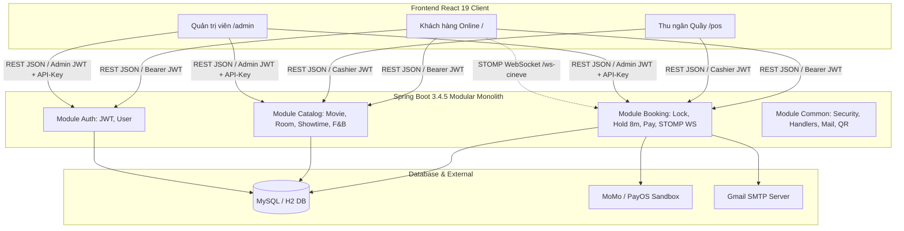
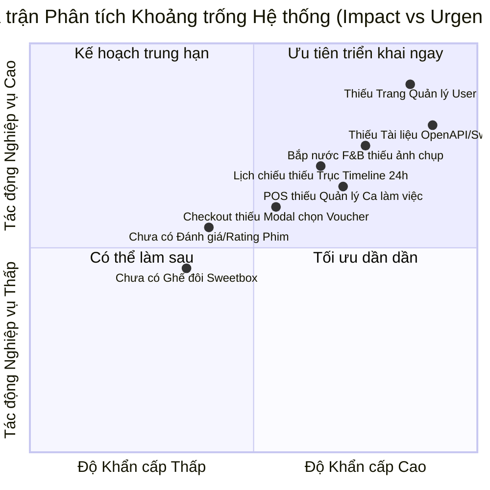
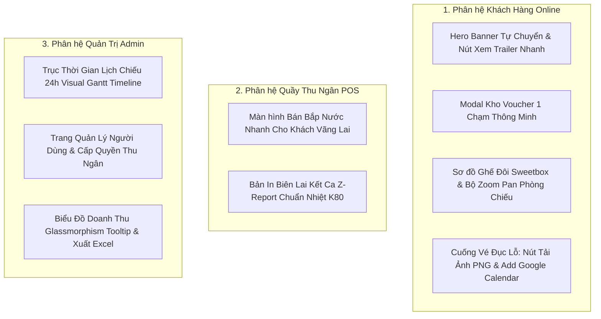
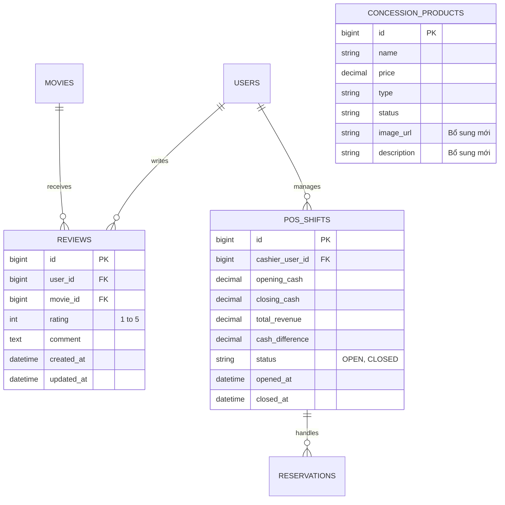
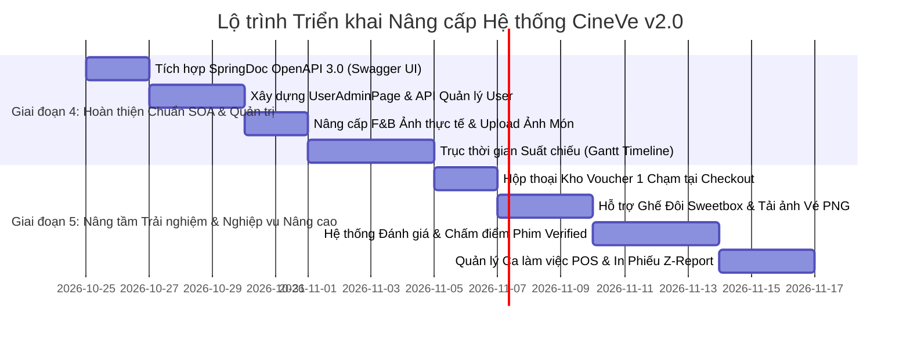

# Kế hoạch Nâng cấp Hệ thống Toàn diện CineVe (Phiên bản 2.0)

> **Tài liệu Kỹ thuật & Nghiệp vụ Nâng cấp Hệ thống**  
> **Đề tài**: Thiết kế và phát triển hệ thống bán vé xem phim theo kiến trúc hướng dịch vụ (Modular Monolith)  
> **Dự án**: CineVe (Backend Spring Boot `vexemphim-api` & Client React `web-client`)  
> **Ngày lập**: 2026-10-22  
> **Phiên bản**: v2.0-Production-Ready  

---

## 📑 MỤC LỤC
1. [Tổng quan Rà soát & Đánh giá Hiện trạng Hệ thống](#1-tổng-quan-rà-soát--đánh-giá-hiện-trạng-hệ-thống)
   - 1.1. Kiến trúc tổng thể & Công nghệ
   - 1.2. Thành tựu kỹ thuật đã hoàn thành (Strengths)
   - 1.3. Ma trận Điểm nghẽn & Khoảng trống Nghiệp vụ (Gaps & Weaknesses)
2. [Kế hoạch Nâng cấp Giao diện & Trải nghiệm (UI/UX Blueprint)](#2-kế-hoạch-nâng-cấp-giao-diện--trải-nghiệm-uiux-blueprint)
   - 2.1. Phân hệ Khách hàng Online (Customer Journey)
   - 2.2. Phân hệ Quầy Thu ngân POS (Fast Cashier Operations)
   - 2.3. Phân hệ Quản trị viên (Admin Visual Portal)
3. [Đặc tả Kỹ thuật Các Chức năng Nâng cấp Mới](#3-đặc-tả-kỹ-thuật-các-chức-năng-nâng-cấp-mới)
   - 3.1. Tài liệu hóa OpenAPI / Swagger 3.0 (Chuẩn SOA)
   - 3.2. Quản lý Tài khoản & Phân quyền trên Admin Portal
   - 3.3. Nâng cấp Bắp Nước (F&B) với Hình ảnh Thực tế
   - 3.4. Hệ thống Đánh giá & Chấm điểm Phim (Verified Movie Reviews)
   - 3.5. Quản lý Ca làm việc POS (Cashier Shifts & Z-Report)
   - 3.6. Kho Voucher Pop-up 1-Chạm tại Checkout
   - 3.7. Sơ đồ Ghế Đôi (Couple / Sweetbox) & Tiện ích Vé
4. [Thiết kế CSDL & Hợp đồng API Mở rộng (DB Schema & REST Contracts)](#4-thiết-kế-csdl--hợp-đồng-api-mở-rộng)
   - 4.1. Bổ sung Bảng và Cột Dữ liệu
   - 4.2. Danh sách REST API mới
5. [Lộ trình Triển khai & Ma trận Ưu tiên (Roadmap & Priority Matrix)](#5-lộ-trình-triển-khai--ma-trận-ưu-tiên)

---

## 1. TỔNG QUAN RÀ SOÁT & ĐÁNH GIÁ HIỆN TRẠNG HỆ THỐNG

### 1.1. Kiến trúc tổng thể & Công nghệ
Hệ thống **CineVe** được xây dựng theo mô hình **Client-Server hướng dịch vụ (Modular Monolith)**:
- **Backend Service (`vexemphim-api`)**:
  - Chạy trên **Java 21** và **Spring Boot 3.4.5**, phân chia thành các module nghiệp vụ tách biệt: `auth`, `catalog`, `booking`, `common`.
  - Kết nối MySQL (kèm profile H2 in-memory), xác thực phân quyền qua JWT (JJWT 0.12.x), bảo vệ Catalog API bằng API Key header `X-API-KEY`.
  - Tích hợp **Spring WebSocket STOMP** cho sơ đồ ghế, **Spring Mail** (SMTP Gmail), **ZXing** tạo mã QR vé, cùng tích hợp thanh toán đa kênh (MoMo Sandbox, PayOS Sandbox, Giả lập Mock, Tiền mặt POS).
- **Client Application (`web-client`)**:
  - Xây dựng bằng **React 19 + TypeScript + Vite**, kết hợp tiện ích Tailwind CSS v4 và Custom Design Tokens.
  - Quản lý trạng thái server bằng `@tanstack/react-query`, thông báo thời gian thực với `sonner`, trực quan hóa biểu đồ doanh thu bằng `recharts`.



---

### 1.2. Thành tựu kỹ thuật đã hoàn thành (Strengths)
1. **Kiểm soát đồng thời & Khóa dữ liệu (Concurrency Control)**:
   - Áp dụng kết hợp khóa bi quan `PESSIMISTIC_WRITE` trên hàng `Showtime` và Unique Index `(showtime_id, seat_id)` tại bảng `reservation_seats`.
   - Ngăn chặn triệt để tình trạng hai người giữ trùng một ghế (Double Booking), giữ ghế tối đa 8 phút có Background Scheduler dọn dẹp chính xác.
   - Thuật toán kiểm tra ghế trống đơn lẻ (`singleGapFromPaid`) chống việc khách cố tình bỏ lẻ 1 ghế giữa các ghế đã bán.
2. **Cơ chế cập nhật trạng thái ghế Real-time**:
   - Sử dụng Spring WebSocket STOMP phát sự kiện cập nhật ô ghế tới toàn bộ client đang mở sơ đồ, kết hợp cơ chế Polling dự phòng 5 giây.
3. **Quy tắc phân kênh chuẩn xác (Business Channel Boundaries)**:
   - Kênh Online đóng bán khi phim bắt đầu (`startAt`), kênh POS cho phép bán vé kéo dài đến hết giờ dọn phòng (`endAt`).
   - Khách có quyền hủy vé online trước giờ chiếu 30 phút, vé đã soát vào cửa (`CHECKED_IN`) bị chặn hủy tuyệt đối.
4. **Trải nghiệm quầy POS hiện đại**:
   - Tích hợp camera quét mã QR vé trực tiếp trên trình duyệt (`BarcodeDetector` API) có âm thanh phản hồi, hỗ trợ in vé nhiệt K80 chuẩn rạp.

---

### 1.3. Ma trận Điểm nghẽn & Khoảng trống Nghiệp vụ (Gaps & Weaknesses)



| STT | Phân hệ / Khu vực | Hiện trạng | Khoảng trống & Hạn chế | Mức độ rủi ro |
|:---:|---|---|---|:---:|
| 1 | **Admin Portal** | Không có trang quản lý tài khoản | Admin không thể tạo nhân viên thu ngân mới, không thể khóa/mở khóa hay reset mật khẩu tài khoản ngoài cách can thiệp tay vào MySQL. | 🔴 **Nghiêm trọng** |
| 2 | **Kiến trúc SOA** | Chưa có Swagger / OpenAPI 3 | Đề tài là môn Hướng dịch vụ nhưng thiếu giao diện tài liệu hóa API tương tác trực tiếp (`/swagger-ui`), gây mất điểm khi bảo vệ đồ án. | 🔴 **Nghiêm trọng** |
| 3 | **F&B (Bắp Nước)** | Chỉ có tên món và giá, dùng icon emoji | Bảng `concession_products` không có trường ảnh `image_url`. Bắp nước là mặt hàng mua theo kích thích thị giác, thiếu ảnh làm giảm tính thương mại. | 🟡 **Cần thiết** |
| 4 | **Admin Suất chiếu** | Danh sách thẻ phòng phẳng | Khó nhìn ra khoảng trống giữa các suất (gap) và khó phát hiện các suất vi phạm quy tắc dọn phòng 15 phút. | 🟡 **Cần thiết** |
| 5 | **Thu ngân POS** | Chưa có quản lý Ca làm việc (Shifts) | Thu ngân không có luồng Mở ca (nhập tiền lẻ ban đầu) / Kết ca (đối soát tổng tiền mặt, in Z-Report). Chưa có chế độ bán bắp nước độc lập cho khách không xem phim. | 🟡 **Cần thiết** |
| 6 | **Khuyến mãi Checkout** | Nhập voucher bằng ô gõ chữ thủ công | Khách không biết rạp đang có những mã giảm giá nào đang hiệu lực để áp dụng. | 🟢 **Nên có** |
| 7 | **Tương tác Phim** | Không có đánh giá (Reviews & Rating) | Khán giả không thể chấm sao (1-5★) hay bình luận sau khi đã xem vé. | 🟢 **Nên có** |

---

## 2. KẾ HOẠCH NÂNG CẤP GIAO DIỆN & TRẢI NGHIỆM (UI/UX BLUEPRINT)



### 2.1. Phân hệ Khách hàng Online (Customer Journey)

#### A. Trang Chủ & Banner Hero (`HomePage.tsx`)
- **Tự động chuyển phim nổi bật (Auto Carousel)**:
  - Tự động chuyển slide sau mỗi 5 giây với hiệu ứng làm mờ chéo (Crossfade 500ms).
  - Có thanh chỉ báo thời gian (progress line) và các nút chấm tròn (Dots indicator).
- **Xem Trailer Nhanh (Inline Quick Preview)**:
  - Nút bấm *"Xem Trailer"* ngay tại Hero banner bật Modal xem YouTube không làm gián đoạn vị trí cuộn trang.
- **Bộ lọc Phim Thông minh Đa tiêu chí**:
  - Tìm kiếm theo tên phim kết hợp tức thì với Chips thể loại (Hành động, Hoạt hình, Kinh dị...) và nhãn độ tuổi (P, K, T13, T16, T18).

#### B. Sơ đồ Chọn Ghế Điện Ảnh (`SeatMapPage.tsx` & `SeatGrid.tsx`)
- **Định dạng Ghế Đôi (Couple / Sweetbox)**:
  - Thiết kế ô ghế đôi dài gấp hai ô ghế thường, bố trí ở hàng cuối cùng của phòng chiếu.
  - Khi người dùng click vào một bên ghế đôi, hệ thống tự động chọn cả 2 ghế trong cặp và tính giá combo ghế đôi.
- **Bộ điều khiển Phóng to & Thu nhỏ (Zoom / Pan Controls)**:
  - Cho phép dùng con lăn chuột (hoặc cử chỉ 2 ngón tay trên điện thoại) để thu phóng và kéo sơ đồ đối với các phòng chiếu lớn trên 150 ghế.
- **Thanh Tóm Tắt Nổi (Sticky Floating Action Bar) trên Mobile**:
  - Ghim cố định ở chân màn hình điện thoại: hiển thị số lượng ghế (`Ghế C04, C05`), đồng hồ đếm ngược giữ chỗ (`07:45`), tổng tiền tạm tính và nút CTA *"Tiếp tục"*.

#### C. Chọn Bắp Nước Hấp Dẫn (`ConcessionPage.tsx`)
- **Hình ảnh Món ăn Sắc nét**:
  - Thay thế toàn bộ biểu tượng cảm xúc (🍿, 🥤) bằng hình ảnh chất lượng cao hiển thị trên từng thẻ món ăn.
  - Bổ sung huy hiệu kích cầu: *"Bán chạy nhất"*, *"Combo tiết kiệm 20%"*.
- **Hoạt họa Tăng Giảm Số Lượng (Micro Flip Counter)**:
  - Khi bấm nút `+` hoặc `−`, số lượng nhảy số với hiệu ứng chuyển động tỷ lệ (scale pop animation) mượt mà.

#### D. Trang Thanh Toán Nhanh (`CheckoutPage.tsx`)
- **Hộp thoại Kho Voucher 1 Chạm (Voucher Wallet Modal)**:
  - Nút *"Chọn hoặc nhập mã ưu đãi"* mở danh sách toàn bộ các Voucher đang có hiệu lực.
  - Hiển thị rõ: Điều kiện áp dụng (Đơn tối thiểu, mức giảm tối đa, hạn sử dụng).
  - Người dùng chỉ cần bấm nút *"Áp dụng"*, mã tự động được điền và trừ tiền ngay tức thì.

#### E. Trang Vé của tôi (`TicketsPage.tsx`)
- **Nút "Lưu ảnh vé" (Export Ticket Image)**:
  - Sử dụng thư viện `html-to-image` kết xuất thẻ vé cuống đục lỗ thành file ảnh `ve-cineve-[ticketCode].png` giúp khách hàng dễ dàng lưu vào điện thoại hoặc gửi cho bạn bè.
- **Nút "Thêm vào Google Calendar"**:
  - Tự động tạo link thêm sự kiện xem phim vào lịch cá nhân với đầy đủ thông tin: Tên phim, thời gian chiếu, phòng chiếu, số ghế và đường link tra cứu vé.

---

### 2.2. Phân hệ Quầy Thu ngân POS (Fast Cashier Operations)

#### A. Chế độ Bán Bắp Nước Nhanh (Fast Snack Walk-in)
- Màn hình chuyên dụng cho quầy F&B: Khách hàng chỉ mua bắp nước mang đi không cần đặt vé phim.
- Thu ngân chọn món, hệ thống tính tổng tiền mặt, bấm *"Thu tiền & In phiếu"* chỉ trong vòng 5 giây.

#### B. Mẫu In Biên Lai Kết Ca (Z-Report Thermal Print)
- Mẫu in bill nhiệt K80 tổng kết ca làm việc:
  - Thời gian mở ca / đóng ca, tên thu ngân, số tiền đầu ca.
  - Tổng số vé đã bán, tổng số bắp nước đã bán.
  - Tổng doanh thu tiền mặt, tổng doanh thu chuyển khoản quét mã.
  - Chữ ký xác nhận bàn giao giữa 2 thu ngân.

---

### 2.3. Phân hệ Quản trị viên (Admin Visual Portal)

#### A. Trục Thời Gian Suất Chiếu 24h (Visual Showtime Timeline)
- Thay thế bảng phẳng bằng trục thời gian Gantt 24 giờ chia theo từng phòng chiếu (`Room 1`, `Room 2`, `Room 3`...):
  - Mỗi suất chiếu là một thanh màu chữ nhật có độ dài tương ứng chính xác với thời lượng phim.
  - Hiển thị trực quan khoảng cách giữa các suất chiếu.
  - Tự động viền đỏ cảnh báo nếu khoảng nghỉ giữa 2 suất liên tiếp nhỏ hơn 15 phút (vi phạm quy tắc dọn phòng chiếu).

```
Phòng 1 ───[ 09:00 - 11:30 | Dune 2 ]── 15m ──[ 11:45 - 13:45 | Conan ]────────
Phòng 2 ──────[ 10:00 - 12:15 | Kung Fu Panda ]─────── ⚠️ 5m (LỖI) ──[ 12:20...]
```

#### B. Trang Quản lý Người Dùng & Phân Quyền (`UserAdminPage.tsx`)
- Bảng danh sách người dùng phân trang: ID, Tên đăng nhập, Email, Vai trò (`ADMIN`, `CASHIER`, `CUSTOMER`), Trạng thái hoạt động, Ngày tạo.
- Hộp thoại tạo mới tài khoản Nhân viên Thu ngân (`CASHIER`) tại quầy.
- Chức năng Khóa / Mở khóa tài khoản (`enabled: true / false`) và Reset mật khẩu tài khoản.

---

## 3. ĐẶC TẢ KỸ THUẬT CÁC CHỨC NĂNG NÂNG CẤP MỚI

### 3.1. Tài liệu hóa OpenAPI / Swagger 3.0 (Chuẩn SOA)
- **Mục tiêu**: Chuẩn hóa toàn bộ các dịch vụ RESTful API theo tài liệu đặc tả OpenAPI Specification 3.0, đáp ứng trọn vẹn yêu cầu bài tập lớn môn Kiến trúc Hướng dịch vụ (SOA).
- **Triển khai**:
  - Bổ sung dependency: `org.springdoc:springdoc-openapi-starter-webmvc-ui:2.8.5`.
  - Cấu hình thông tin hệ thống, nhóm API theo từng module (`Auth Service`, `Catalog Service`, `Booking & POS Service`).
  - Tích hợp cấu hình Security Scheme Bearer JWT Token để thầy cô/hội đồng có thể đăng nhập và kiểm thử gọi API trực tiếp ngay trên trình duyệt tại URL: `http://localhost:8080/swagger-ui/index.html`.

---

### 3.2. Quản lý Tài khoản & Phân quyền trên Admin Portal
- **Phân quyền truy cập**: Chỉ tài khoản có vai trò `ADMIN` mới được phép gọi các API quản lý tài khoản người dùng.
- **Các API cần bổ sung**:
  - `GET /api/users`: Lấy danh sách người dùng có phân trang, tìm kiếm theo username, email, lọc theo role.
  - `POST /api/users/cashiers`: Admin tạo tài khoản nhân viên thu ngân mới (bắt buộc gồm username, password, email).
  - `PATCH /api/users/{id}/status`: Khóa hoặc kích hoạt lại tài khoản người dùng.
  - `PATCH /api/users/{id}/password`: Đặt lại mật khẩu mới cho tài khoản.

---

### 3.3. Nâng cấp Bắp Nước (F&B) với Hình ảnh Thực tế
- **Cơ sở dữ liệu**:
  - Thêm cột `image_url VARCHAR(512)` vào bảng `concession_products`.
  - Thêm cột `description TEXT` để mô tả chi tiết thành phần combo (ví dụ: *"Gồm 1 bắp rang lớn 32oz phô mai + 2 ly Coca 22oz"*).
- **Backend**:
  - Cập nhật `ConcessionProduct.java`, `ConcessionRequest.java`, `ConcessionResponse.java`.
  - Mở rộng chức năng upload ảnh món ăn F&B thông qua `FileStorageService` (tương tự chức năng upload poster phim hiện có).
- **Frontend**:
  - Bổ sung chức năng tải ảnh món ăn trong trang `ConcessionAdminPage.tsx`.
  - Hiển thị hình ảnh thực tế tại `ConcessionPage.tsx` và popup tại màn hình POS.

---

### 3.4. Hệ thống Đánh giá & Chấm điểm Phim (Verified Movie Reviews)
- **Quy tắc nghiệp vụ**:
  - **Xác thực mua vé (Verified Booking)**: Chỉ khách hàng có tài khoản đã từng mua vé xem bộ phim đó và vé đã qua bước soát vé (`CHECKED_IN`) mới được quyền gửi đánh giá.
  - Mỗi tài khoản chỉ được gửi 01 đánh giá cho mỗi bộ phim (có thể chỉnh sửa nội dung đánh giá của mình).
  - Thang điểm: Từ 1 đến 5 sao, kèm bình luận văn bản tối đa 500 ký tự.
- **Tính toán tự động**:
  - Hệ thống tự động tính điểm đánh giá trung bình `rating_average` và tổng số lượt đánh giá `rating_count` của từng phim để trả về kèm thông tin phim trong `MovieResponse`.

---

### 3.5. Quản lý Ca làm việc POS (Cashier Shifts & Z-Report)
- **Quy trình vận hành ca**:
  1. **Bắt đầu ca (`OPEN`)**: Nhân viên thu ngân bấm *"Mở ca"* trên trang `/pos`, nhập số tiền mặt đầu ca trong két (ví dụ: `500.000đ`).
  2. **Trong ca**: Tất cả giao dịch thanh toán tiền mặt qua POS (`confirmCash`) tự động liên kết với mã ca `shift_id` đang mở của thu ngân đó.
  3. **Kết thúc ca (`CLOSED`)**: Thu ngân bấm *"Kết thúc ca"*, nhập số tiền mặt kiểm đếm thực tế trong két.
  4. **Xuất Báo cáo Z-Report**: Hệ thống so sánh:
     $$\text{Chênh lệch} = \text{Tiền mặt thực tế} - (\text{Tiền đầu ca} + \text{Tổng tiền bán vé trong ca})$$
     In phiếu nhiệt K80 bàn giao ca có chữ ký xác nhận.

---

### 3.6. Kho Voucher Pop-up 1-Chạm tại Checkout
- **Backend API**:
  - Bổ sung endpoint: `GET /api/vouchers/available?orderAmount={amount}`.
  - Trả về danh sách tất cả voucher đang ở trạng thái `ACTIVE`, còn trong thời hạn hiệu lực, chưa chạm mốc `usage_limit`, và thỏa mãn giá trị đơn hàng tối thiểu `min_order_amount`.
- **Frontend UI**:
  - Tại bước thanh toán `CheckoutPage.tsx`, người dùng bấm nút *"Kho Voucher"*. Modal mở ra liệt kê các mã kèm số tiền được giảm dự tính, bấm *"Áp dụng"* là voucher tự động điền và kích hoạt.

---

### 3.7. Sơ đồ Ghế Đôi (Couple / Sweetbox) & Tiện ích Vé
- **Cơ sở dữ liệu**:
  - Bổ sung giá trị `COUPLE` vào trường `Seat.type` (hiện đang có: `STANDARD`, `VIP`).
  - Thêm trường `pair_seat_id BIGINT NULL` chỉ định ID của chiếc ghế còn lại trong cặp ghế đôi.
- **Luồng giữ ghế đôi**:
  - Khi client gửi yêu cầu giữ 1 ghế có kiểu `COUPLE`, backend tự động thêm chiếc ghế đôi đi kèm vào danh sách `holdSeats`.
  - Giá vé ghế đôi được tính tương ứng bằng 2 lần đơn giá ghế hoặc áp dụng hệ số riêng theo cài đặt rạp.

---

## 4. THIẾT KẾ CSDL & HỢP ĐỒNG API MỞ RỘNG

### 4.1. Bổ sung Bảng và Cột Dữ liệu (Schema Enhancements)



#### A. Cập nhật bảng `concession_products`
```sql
ALTER TABLE concession_products 
ADD COLUMN image_url VARCHAR(512) NULL AFTER status,
ADD COLUMN description TEXT NULL AFTER image_url;
```

#### B. Cập nhật bảng `seats` (Hỗ trợ Ghế Đôi)
```sql
ALTER TABLE seats 
ADD COLUMN pair_seat_id BIGINT NULL AFTER type;
```

#### C. Bảng Đánh giá Phim (`reviews`)
```sql
CREATE TABLE reviews (
    id BIGINT AUTO_INCREMENT PRIMARY KEY,
    user_id BIGINT NOT NULL,
    movie_id BIGINT NOT NULL,
    rating INT NOT NULL CHECK (rating >= 1 AND rating <= 5),
    comment TEXT NULL,
    created_at DATETIME NOT NULL DEFAULT CURRENT_TIMESTAMP,
    updated_at DATETIME NULL ON UPDATE CURRENT_TIMESTAMP,
    CONSTRAINT uk_user_movie UNIQUE (user_id, movie_id),
    CONSTRAINT fk_review_user FOREIGN KEY (user_id) REFERENCES users(id),
    CONSTRAINT fk_review_movie FOREIGN KEY (movie_id) REFERENCES movies(id)
);
```

#### D. Bảng Quản lý Ca bán hàng POS (`pos_shifts`)
```sql
CREATE TABLE pos_shifts (
    id BIGINT AUTO_INCREMENT PRIMARY KEY,
    cashier_user_id BIGINT NOT NULL,
    opening_cash DECIMAL(12,2) NOT NULL DEFAULT 0,
    closing_cash DECIMAL(12,2) NULL,
    total_sales_cash DECIMAL(12,2) NOT NULL DEFAULT 0,
    difference DECIMAL(12,2) NULL,
    status VARCHAR(16) NOT NULL DEFAULT 'OPEN',
    opened_at DATETIME NOT NULL DEFAULT CURRENT_TIMESTAMP,
    closed_at DATETIME NULL,
    CONSTRAINT fk_shift_cashier FOREIGN KEY (cashier_user_id) REFERENCES users(id)
);
```

---

### 4.2. Danh sách REST API Mới

| Method | Endpoint | Quyền (Role) | Mô tả chức năng |
|---|---|:---:|---|
| `GET` | `/api/users` | `ADMIN` | Lấy danh sách người dùng (phân trang, tìm kiếm) |
| `POST` | `/api/users/cashiers` | `ADMIN` | Tạo tài khoản nhân viên thu ngân mới |
| `PATCH` | `/api/users/{id}/status` | `ADMIN` | Bật/tắt trạng thái hoạt động của tài khoản |
| `PATCH` | `/api/users/{id}/password` | `ADMIN` | Đặt lại mật khẩu tài khoản người dùng |
| `POST` | `/api/concessions/{id}/image` | `ADMIN` | Tải lên hình ảnh món bắp nước |
| `GET` | `/api/movies/{id}/reviews` | Public | Xem danh sách đánh giá của một bộ phim |
| `POST` | `/api/movies/{id}/reviews` | `CUSTOMER` | Gửi bài đánh giá phim (yêu cầu đã xem vé) |
| `GET` | `/api/vouchers/available` | `CUSTOMER` | Lấy danh sách voucher đủ điều kiện cho giỏ hàng |
| `GET` | `/api/pos/shifts/current` | `CASHIER` | Kiểm tra ca làm việc hiện tại của thu ngân |
| `POST` | `/api/pos/shifts/open` | `CASHIER` | Mở ca làm việc mới kèm số tiền đầu ca |
| `POST` | `/api/pos/shifts/close` | `CASHIER` | Kết thúc ca làm việc và tính toán chênh lệch két |
| `GET` | `/swagger-ui/index.html` | Public | Giao diện tài liệu tương tác API OpenAPI 3.0 |

---

## 5. LỘ TRÌNH TRIỂN KHAI & MA TRẬN ƯU TIÊN



### 🎯 Thứ tự Thực hiện Đề xuất:

#### Bước 1: Chuẩn hóa Kiến trúc Hướng Dịch vụ (SOA) & Quản lý Tài khoản (1 tuần)
- **Tích hợp Swagger UI 3.0**: Thêm dependency `springdoc-openapi-starter-webmvc-ui` vào `pom.xml`, cấu hình Bearer JWT.
- **Trang Quản lý Người dùng (`UserAdminPage.tsx`)**: Tạo Controller, Service và giao diện Admin để tạo tài khoản nhân viên thu ngân và quản lý danh sách người dùng.
- **Hình ảnh Bắp Nước**: Bổ sung `image_url` cho `ConcessionProduct`, tích hợp upload ảnh để biến danh mục bắp nước thành menu điện ảnh chuyên nghiệp.

#### Bước 2: Nâng tầm Trải nghiệm Khách hàng & Quầy POS (1 tuần)
- **Kho Voucher 1 Chạm**: Tạo API `/api/vouchers/available` và modal danh sách ưu đãi tại `CheckoutPage`.
- **Ghế Đôi Sweetbox & Tiện ích Vé**: Hỗ trợ ghép đôi ghế ở hàng cuối cùng; thêm tính năng tải ảnh vé PNG và thêm vào Google Calendar.
- **Quản lý Ca POS & Đánh giá Phim**: Hoàn thiện tính năng mở/đóng ca bán vé cho thu ngân kèm in Z-Report, và kích hoạt đánh giá cho khán giả đã xem phim.

---

> **Kết luận**:  
> Bản kế hoạch nâng cấp này giúp CineVe giữ vững các quy tắc cốt lõi về concurrency và toàn vẹn dữ liệu, đồng thời hoàn thiện sản phẩm theo chuẩn một hệ thống thương mại thực thụ: giao diện điện ảnh lôi cuốn, phân hệ quản trị toàn diện, và tài liệu API chuẩn chỉ cho bài tập lớn/đồ án môn học.
